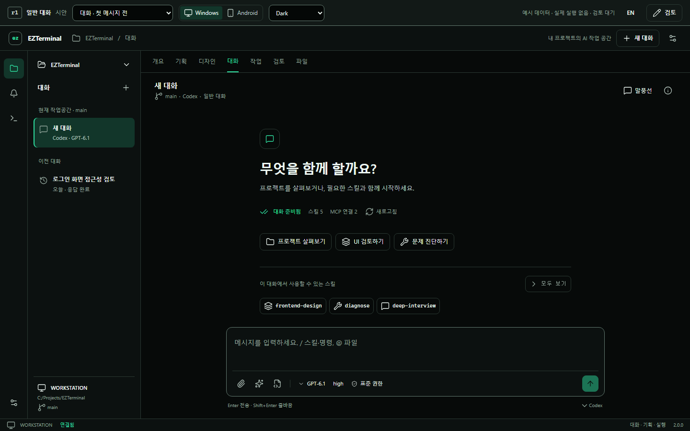
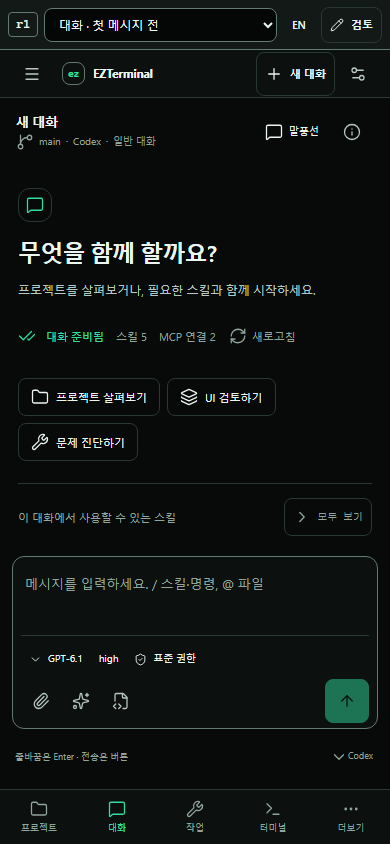

# EZTerminal 2.0 일반 대화 · r1 검토 시안

**상태: 검토 대기.** Windows·Android 일반 대화와 확장 관리의 클릭 가능한 시안입니다. 사용자가 디자인 버전을 확정한 뒤 제품에 반영하는 순서입니다. 기존 r6 승인, 제품 구현 완료 또는 출시 승인을 의미하지 않습니다.

[시안 열기](index.html) · [화면·동작 계약](UI-CONTRACT.md) · [제공자 근거와 미확인 항목](SUPPORT.md) · [화면 검토 및 검증](VISUAL-REVIEW.md)

`index.html`을 Chrome 또는 Edge에서 열면 서버 없이 사용할 수 있습니다. 화면 위의 장면 선택으로 25개 상태를 바로 열고 Windows/Android, KO/EN, 테마를 전환합니다. 좁은 화면에서는 **검토** 안에서 기기와 테마를 바꿉니다. 대화 헤더의 **말풍선 / CLI 스킨**은 같은 대화 상태를 유지합니다.

## 먼저 볼 화면

| Windows | Android |
| --- | --- |
| [첫 메시지 전](index.html?scene=welcome&device=desktop) | [첫 메시지 전](index.html?scene=welcome&device=mobile) |
| [스킬 선택](index.html?scene=skills&device=desktop) | [스킬 선택 시트](index.html?scene=skills&device=mobile) |
| [설치된 확장](index.html?scene=installed&device=desktop) | [PC 확장 원격 관리](index.html?scene=installed&device=mobile) |
| [플러그인 상세](index.html?scene=plugin&device=desktop) | [PC에서 MCP 인증](index.html?scene=mcp-auth&device=mobile) |
| [Claude 시작 화면](index.html?scene=welcome&provider=claude&device=desktop) | [연결 끊김 복구](index.html?scene=offline&device=mobile) |





## 검토할 다섯 흐름

1. **첫 입력 전 준비:** 첫 화면에서 스킬 수와 MCP 상태 확인 → 스킬 선택 → 모델·추론·권한 변경 → 메시지 작성. 선택하거나 설정하는 것만으로 응답이 시작되지 않아야 합니다.
2. **설치하고 원래 대화로 복귀:** 스킬·첨부와 첫 입력 장면 → 확장 → 직접 추가 → Git 주소 또는 PC 폴더 → 제공자·범위 검토 → 설치 → 대화로 → 원래 초안에 새 스킬 추가.
3. **진행 중 상호작용:** 사용자 질문, 작업 승인, 대기열 장면에서 답변·거절·대기 메시지 편집 → 중단 → 명시적으로 이어가기. 질문 답변과 실행 승인은 별개입니다.
4. **Android에서 PC 관리:** 설치된 확장 → 제공자 선택 → 플러그인 활성화·업데이트·삭제 또는 MCP 설정 → PC 인증 안내. 적용 대상이 항상 WORKSTATION임을 확인합니다.
5. **문제가 생겨도 이어가기:** 오프라인, 전송 결과 확인 중, 설정 충돌, 새 대화부터 적용 장면. 초안을 보존하고 재연결만으로 재전송하지 않는지 검토합니다.

## 기록과 확정

**검토**에서 장면·기기·제공자별 의견을 저장하고 JSON으로 내보내거나 가져올 수 있습니다. 저장 위치는 이 브라우저의 localStorage입니다. 브라우저가 로컬 파일 저장을 제한하면 내보내기를 사용합니다. 검토 기록의 `reviewed`는 사용자 디자인 확정이 아닙니다. 시안 자체에는 승인 버튼이 없습니다.

장면을 바꾸면 해당 예시 상태로 초기화됩니다. 대화 초안·예시 설치는 페이지 안의 메모리에만 존재하며 새로고침 시 초기화됩니다. 검토 의견만 브라우저에 남습니다. 이 차이는 실제 제품의 영구 저장 계약을 바꾸지 않습니다.

## 재현

저장소 루트에서 기존 의존성이 설치된 환경으로 실행합니다.

```powershell
node docs/ux/reference/v2-agent-chat-r1/build.mjs
node docs/ux/reference/v2-agent-chat-r1/verify.mjs
```

`build.mjs`는 기존 토큰과 Lucide 아이콘의 참조 사본 및 원본 해시를 생성합니다. `verify.mjs`는 Chromium에서 흐름, 스크린샷, 넘침, 키보드 동작, 선택된 장면의 axe 접근성을 검사합니다. 결과는 [qa-report.json](qa-report.json)에 기록됩니다. `--smoke`는 첫 화면 선택 흐름만 확인하는 축약 실행입니다.

AI 응답·설치·인증·MCP 연결은 모두 예시 상태 전환입니다. 네트워크 요청, 실제 파일 접근, 제공자 계정 접근 또는 PC 설정 변경을 수행하지 않습니다. Android 화면은 브라우저 시안이며 실제 APK·키보드 검증 결과는 포함하지 않습니다.
