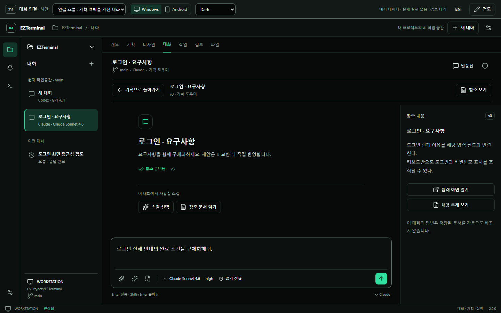
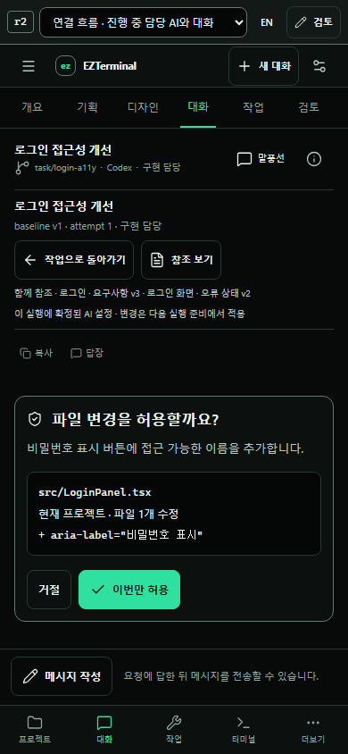

# EZTerminal 2.0 · 단계와 이어지는 대화 r2

**검토 대기 시안.** 기존 기획·디자인·작업·검토를 공통 대화 화면과 연결합니다. 이전 [r1](../v2-agent-chat-r1/README.md)은 보존했고, r2에서 연결 흐름을 보완했습니다. 제품 코드는 변경하지 않았습니다.

[프로젝트부터 체험](index.html) · [기획 대화 바로 보기](index.html?scene=flow-plan-chat) · [Android로 보기](index.html?scene=flow-plan-chat&device=mobile) · [UX 연결 계약](UI-CONTRACT.md)

`index.html`을 Chrome/Edge에서 열면 서버 없이 체험할 수 있습니다. 상단은 시안 검토 도구이며 제품 메뉴에 포함되지 않습니다. 기기·언어·테마·장면 선택과 **검토** 의견 저장을 제공합니다. 기존 일반 대화·스킬·플러그인·MCP 장면도 같은 패키지에 남아 있습니다.

## r1에서 보완한 연결

| 출발 화면 | 대화에 보이는 맥락 | 돌아와서 할 일 |
| --- | --- | --- |
| 기획 | 선택한 요구사항·완료 조건·참조 버전 | 변경안 비교 → 명시 적용 → 문서 새 버전 |
| 디자인 | 선택한 화면 상태 + 연결된 요구사항 버전 | 화면 제안 비교 → 디자인 반영 |
| 작업 | 확정한 기획·디자인 + 작업·현재 실행 + 역할별 AI | 담당 AI 요청에 응답 → 같은 실행 계속 |
| 검토 | 정확한 결과 버전·변경 내용·검증 + 독립 검토 AI | 근거 확인 → 로컬 통합 여부 결정 |

대화 화면·입력·스킬 선택·첨부·말풍선/CLI 스킨은 공통입니다. 각 역할의 대화는 필요한 경우 별도 세션을 사용하며, 문서와 결과 참조로 연결합니다. 실행 중인 담당 AI를 열 때 새 작업을 시작하지 않습니다. 독립 검토 AI와 구현 담당 AI를 구분합니다.

## 한 번에 이어서 체험

1. **기획 → AI와 대화:** 미리 작성된 메시지를 보내고 **변경안 만들기**를 누릅니다. 원본과 제안을 비교한 뒤 **이 변경안 적용**으로 문서에 돌아옵니다.
2. **연결된 디자인 보기 → AI와 대화:** 앞 단계에서 반영한 요구사항이 함께 참조됩니다. 같은 방식으로 디자인 변경안을 비교·적용합니다.
3. **작업 내용 확인 → 기준 확인·실행 준비:** 문서 버전과 역할별 AI를 확인합니다. 준비만으로 작업은 시작되지 않습니다. 별도로 **실행 시작**을 누릅니다.
4. **담당 AI 대화:** 파일 변경 요청을 확인하고 **이번만 허용**하면 예시 결과가 나타납니다. 작업 화면에 다녀와도 같은 대화를 다시 엽니다.
5. **변경 결과 확인 → 독립 검토 시작:** 검토 대화는 같은 결과 r1을 참조합니다. 결과로 돌아와 **검토하고 로컬 통합**을 확인합니다.

각 이동은 작성 중인 대화와 문서 편집을 유지합니다. 대화의 답변, 문서 반영, 실행 시작, 로컬 통합은 서로 다른 동작입니다. 일반 **새 대화**는 기획을 거치지 않고 시작할 수 있습니다.

## 추가로 확인할 장면

- [원본 버전이 바뀐 변경안](index.html?scene=flow-stale): 기존 제안으로 새 원본을 덮어쓰지 않습니다.
- [실행 중 담당 AI](index.html?scene=flow-task-chat&device=mobile): 모바일 승인 중에는 입력창을 접어 요청 내용을 확보합니다. **메시지 작성**으로 초안을 다시 펼칠 수 있습니다.
- [정확한 결과를 보는 검토 대화](index.html?scene=flow-review-chat): 구현 담당의 대화와 구분됩니다.
- [일반 대화 첫 화면](index.html?scene=welcome): 문서 연결 없이도 스킬·모델을 먼저 확인합니다.





## 검증과 실행 경계

```powershell
node docs/ux/reference/v2-agent-chat-r2/build.mjs
node docs/ux/reference/v2-agent-chat-r2/verify.mjs
node docs/ux/reference/v2-agent-chat-r2/verify-journey.mjs
```

[공통 시안 검사](qa-report.json)와 [단계 연결 검사](journey-report.json)는 별도 기록입니다. 검증 범위와 남은 확인은 [VISUAL-REVIEW.md](VISUAL-REVIEW.md), 실제 기존 코드와의 대응은 [INTEGRATION.md](INTEGRATION.md)에 기록합니다.

문서·대화·설치·승인·통합은 모두 메모리의 예시 데이터입니다. 실제 파일·계정·AI·PC 설정·Git을 조작하지 않습니다. 새로고침하면 체험 상태가 초기화되고 검토 의견만 브라우저에 저장됩니다. **검토 완료** 기록은 디자인 승인이 아닙니다. 사용자 확정 후 제품 연동을 구현하는 순서는 유지합니다.
