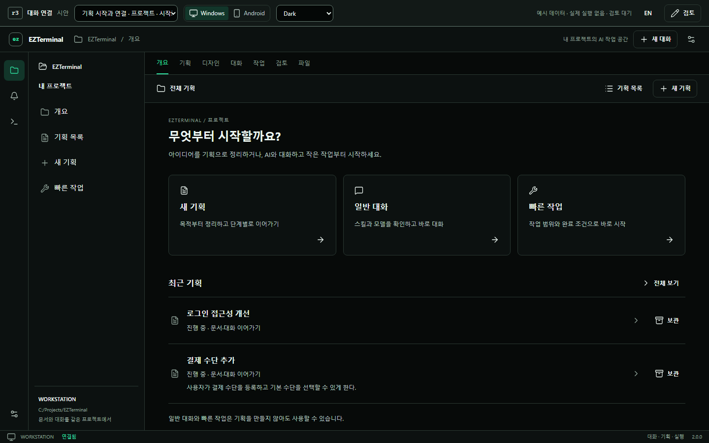
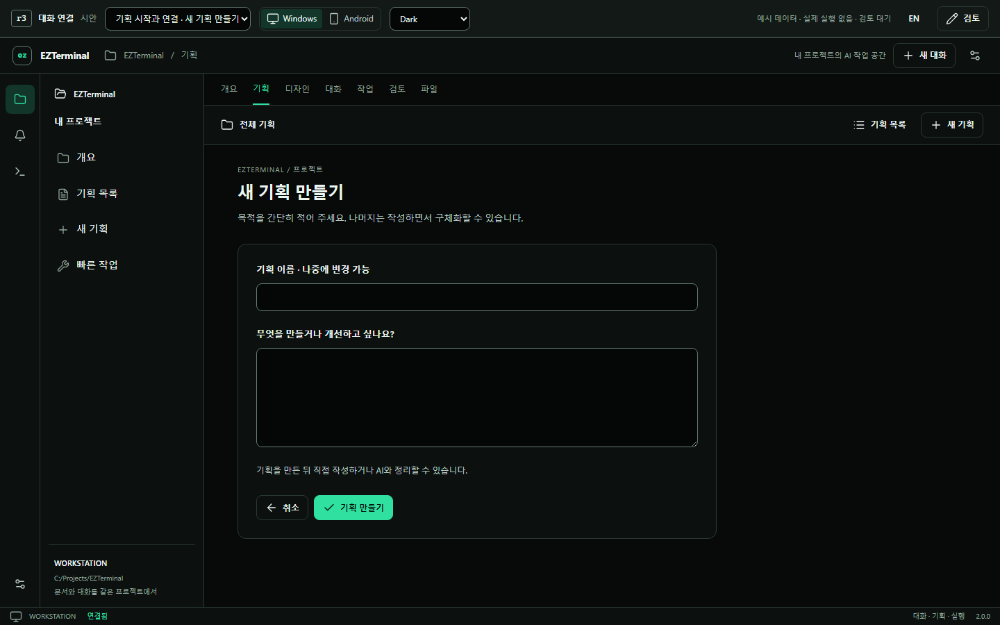

# EZTerminal 2.0 · 기획 시작과 대화 연결 r3

**검토 대기 시안.** [시안 열기](index.html) · [Android 보기](index.html?device=mobile) · [새 기획](index.html?scene=plans-new) · [대화에서 기획으로](index.html?scene=plans-from-chat)

`index.html`을 Chrome/Edge에서 열면 서버 없이 체험할 수 있습니다. 상단에서 Windows/Android,
장면, 언어와 테마를 선택합니다. 상단 검토 도구와 예시 데이터는 제품 메뉴가 아닙니다.

## 바로 해볼 흐름

1. **새 기획:** 첫 화면의 새 기획 → 이름·목적 입력 → 기획 만들기 → 직접 작성 또는 AI와 대화.
2. **여러 기획:** 로그인 기획에 문서/대화 초안 작성 → 기획 목록 → 결제 기획 → 다시 로그인 기획.
   각 문서와 대화 입력이 독립적으로 남습니다. 기획 이름을 눌러 이름도 변경할 수 있습니다.
3. **대화부터 시작:** 장면에서 ‘대화를 기획으로 연결’ → 기획으로 정리 → 새 기획/기존 기획 선택.
   원래 메시지와 작성 중인 입력을 유지한 채 같은 대화를 이어갑니다.
4. **빠른 작업:** 목적·대상 경로·완료 조건 → 작업 내용 확인 → 기준 확인·실행 준비 → 실행 시작.
   기획 목록에 새 기획을 만들지 않습니다. 프로젝트의 작업 영역에서 다시 찾을 수 있습니다.
5. **단계 연결:** 기획 대화에서 메시지 전송 → 변경안 만들기 → 비교·적용 → 디자인 → 작업 → 검토.
   문서 반영, 실행 시작과 로컬 통합은 각각 명시적으로 선택합니다.
6. **다시 수정:** ‘검토 후 수정으로 돌아가기’ 장면 → 수정 요청 정리 → 기획으로 돌아가기.
   이전 결과와 수정 요청을 확인하면서 다음 수정 내용을 작성할 수 있습니다.

기획 목록에서 검색·보관·복원도 체험할 수 있습니다. 일반 대화의 첫 메시지 전 스킬 선택,
확장 관리, 말풍선/CLI 스킨은 이전 시안과 같은 공통 화면을 사용합니다.

## 화면 미리보기





## 범위와 근거

- [수정한 개선 계획](../../agent-workflow-plan.md)의 생성·전환·대화 연결을 화면으로 보완했습니다.
- [UX 보완 계약](UI-CONTRACT.md), [기존 구현과 연결](INTEGRATION.md), [검토·검증 기록](VISUAL-REVIEW.md)을 참고하세요.
- r1/r2와 r6 승인본을 보존했습니다. r3는 사용자 디자인 승인이나 제품 구현 완료 상태가 아닙니다.
- 45개 장면은 예시 데이터입니다. 문서·기획·실행 상태는 페이지 메모리에만 남고 새로고침하면 초기화됩니다.
  검토 의견만 브라우저에 저장됩니다. 실제 AI·파일·Git·확장 설정·계정은 변경하지 않습니다.
- 모든 계획 항목이 시안에 구현된 것은 아닙니다. 실제 데이터 이전·영구 복구·실행 범위 선택·기획 간
  동시 실행·물리 Android 입력 등은 [검토 기록](VISUAL-REVIEW.md)에 남은 범위를 명시했습니다.

## 시안 검사

```powershell
node docs/ux/reference/v2-agent-chat-r3/build.mjs
node docs/ux/reference/v2-agent-chat-r3/verify.mjs
node docs/ux/reference/v2-agent-chat-r3/verify-journey.mjs
node docs/ux/reference/v2-agent-chat-r3/verify-plans.mjs
node docs/ux/reference/v2-agent-chat-r3/build.mjs
```

마지막 build는 실제 검사 기록과 캡처를 manifest에 포함합니다. 시안 검사를 제품 E2E나 실제
provider 검증으로 해석하지 않습니다. 성능 벤치마크는 포함하지 않습니다.
