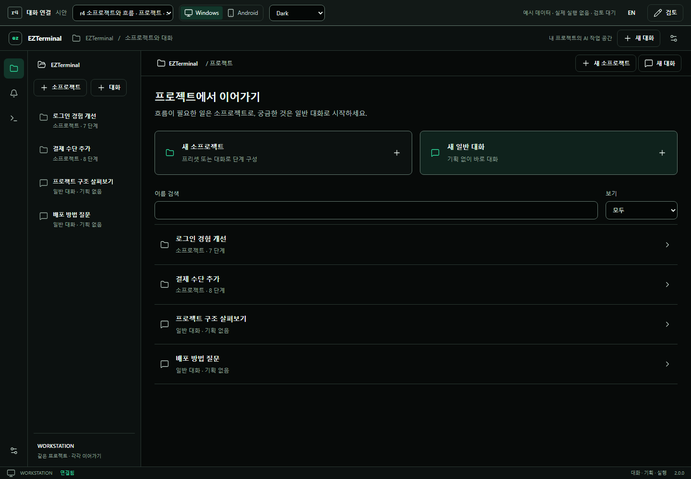
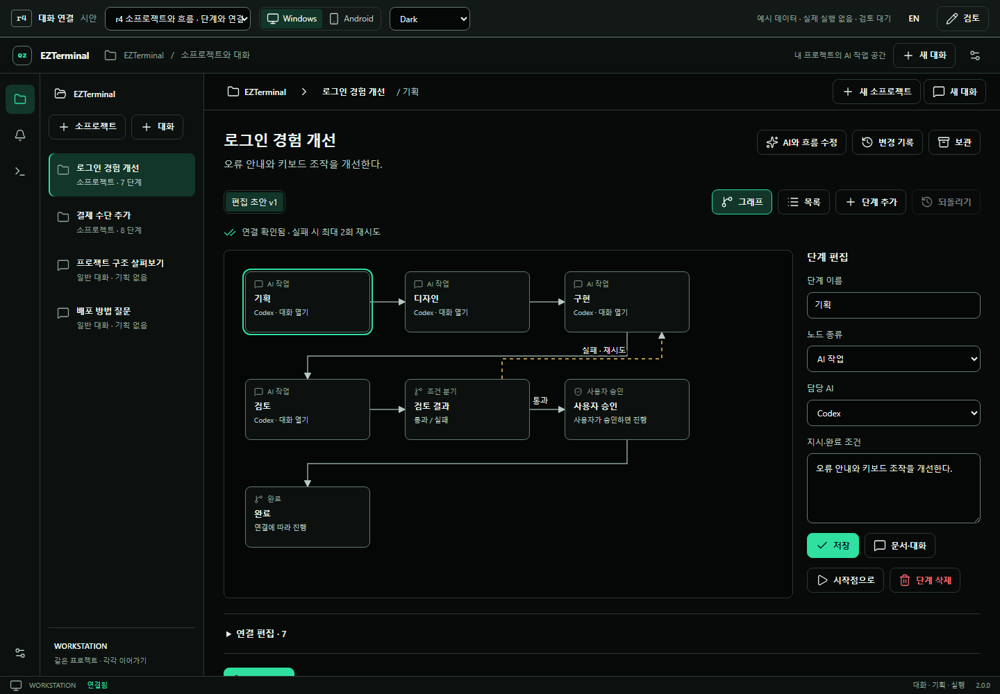

# EZTerminal 2.0 · 소프로젝트와 실행 흐름 r4

**사용자 검토 후보 · 제품 구현 아님.** [r4 열기](index.html) · [Android](index.html?device=mobile) ·
[흐름 그래프](index.html?scene=work-graph) · [일반 대화](index.html?scene=work-general)

Chrome/Edge에서 `index.html`을 열면 서버 없이 체험할 수 있습니다. 기본 화면에는 **소프로젝트와
일반 대화가 같은 깊이**로 나옵니다. 소프로젝트는 앞서 논의한 ‘기획’과 같은 작업 단위입니다.

## 직접 해볼 흐름

1. **계획 없이 대화:** 새 일반 대화 → 스킬 확인 → 메시지 작성 → 프로젝트로 복귀 → 같은 대화 재개.
   소프로젝트를 만들지 않습니다. 첫 메시지 전 `ezterminal-workflow` 스킬도 선택할 수 있습니다.
2. **프리셋으로 생성:** 새 소프로젝트 → 이름·목표 → 기능 개발/문제 수정/조사/병렬 구현/직접 구성 → 만들기.
   생성 전 취소는 항목을 남기지 않습니다. 프리셋과 단계는 이후에도 편집할 수 있습니다.
3. **대화로 생성:** 새 소프로젝트 → 대화로 구성 → ‘화면·API 병렬 구현’ 예시 → 흐름 구성하기 → 만들기.
   생성 전에 오른쪽(모바일은 아래쪽) 단계 미리보기로 확인합니다.
4. **그래프 편집:** 노드 선택 → 이름·종류·담당 AI·지시 저장. 단계 추가/삭제와 ‘연결 편집’에서 출발·도착·조건을
   바꿀 수 있습니다. 연결 오류가 있으면 초안은 남고 실행 준비가 비활성화됩니다. 목록 보기로도 같은 작업이 가능합니다.
5. **단계별 여러 대화:** 노드 선택 → 문서·대화 → 대화 이어가기/새 단계 대화. 문서·대화 입력을 남긴 채 다른
   단계·소프로젝트·일반 대화로 이동했다가 돌아와 보세요. 같은 session의 r3 공통 채팅을 사용합니다.
6. **AI로 직접 수정:** AI와 흐름 수정 → “디자인 단계는 빼고 보안 검토를 추가해줘” 전송 → 그래프 확인 → 되돌리기.
   초안을 직접 수정하고 이력을 남깁니다. 단계의 일반 논의를 흐름 수정 명령으로 처리하지 않습니다.
7. **실행 체험:** 실행 준비 → 버전 확인 → 이 버전으로 시작 체험 → 다음 진행 체험. 검토 결과 예시를 실패로
   바꾸면 실패 연결을 따라 돌아가고 2회 재시도 이후 멈춥니다. 병렬 프리셋은 두 작업이 모인 뒤 합류합니다.
   승인 노드에서는 ‘이 단계 승인’을 눌러야 진행합니다. 실행 중 초안을 수정해도 실행 그래프는 그대로입니다.
8. **일반 대화 연결:** 일반 대화 → 소프로젝트에 연결 → 기존 소프로젝트의 단계 또는 새 소프로젝트.
   원래 세션·메시지·입력·제공자를 유지하고 문서를 덮어쓰거나 실행을 시작하지 않습니다.

보관·복원, 이름 검색·유형 필터, 삭제한 단계의 대화 열기, 변경 이력과 일시정지도 체험할 수 있습니다.
상단의 장면 선택에는 r4 13개 장면과 **이전 r1–r3 비교** 45개 장면이 있습니다. 이전 장면은 기존
확장 관리·문서 제안·빠른 작업·독립 검토의 비교용이며 r4의 최신 탐색 구조와 구분합니다.

## 미리보기





## 범위와 제한

- [수정 계획](../../agent-workflow-plan.md), [UX 후보 계약](UI-CONTRACT.md),
  [제품 연결 경계](INTEGRATION.md), [검토·검증 기록](VISUAL-REVIEW.md)을 함께 봅니다.
- 메모리에서만 동작합니다. 새로고침하면 작업 상태가 초기화되며 검토 의견만 브라우저에 저장합니다.
- AI 응답은 제한된 예시 문장 처리입니다. 실행은 실제 연결선을 따르는 모형이며 실제 AI·파일·Git·계정·
  확장 설정을 변경하지 않습니다. 앱 스킬도 실제 설치하거나 연결한 것이 아닙니다.
- 그래프 노드 이동/드래그 연결, 확대/축소, 자유 형식 AI, 영구 저장·오프라인 복구·동시 편집, 실제 provider,
  실제 Android IME와 앱 밖 스킬 연결은 구현하지 않았습니다. 노드/연결 폼으로 편집 동작을 검토합니다.
- r1–r3와 승인된 r6 원본은 보존합니다. r4에 대한 디자인 승인·제품 구현은 별도 상태입니다.

## 검증 재현

```powershell
node docs/ux/reference/v2-agent-chat-r4/build.mjs
node docs/ux/reference/v2-agent-chat-r4/verify-workflows.mjs
node docs/ux/reference/v2-agent-chat-r4/verify.mjs
node docs/ux/reference/v2-agent-chat-r4/verify-journey.mjs
node docs/ux/reference/v2-agent-chat-r4/verify-plans.mjs
node docs/ux/reference/v2-agent-chat-r4/build.mjs
node docs/ux/reference/v2-agent-chat-r4/verify-package.mjs
```

마지막 build는 보고서와 캡처를 manifest에 포함합니다. 이 검사를 제품 E2E나 성능 측정으로 해석하지 않습니다.
