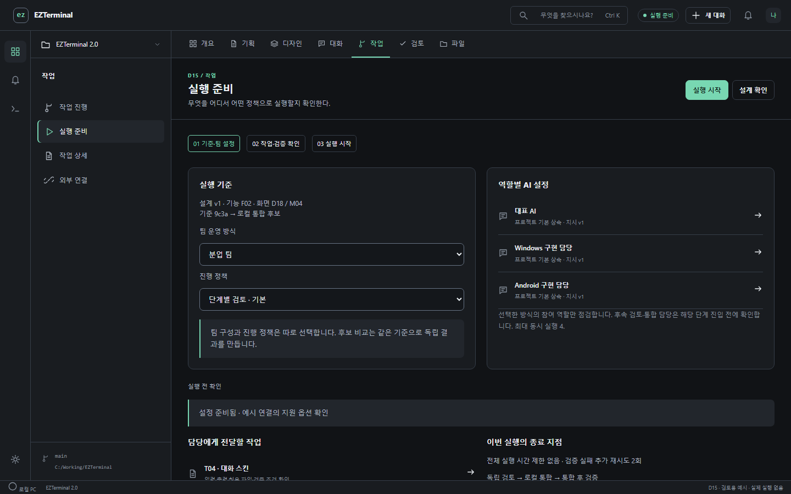
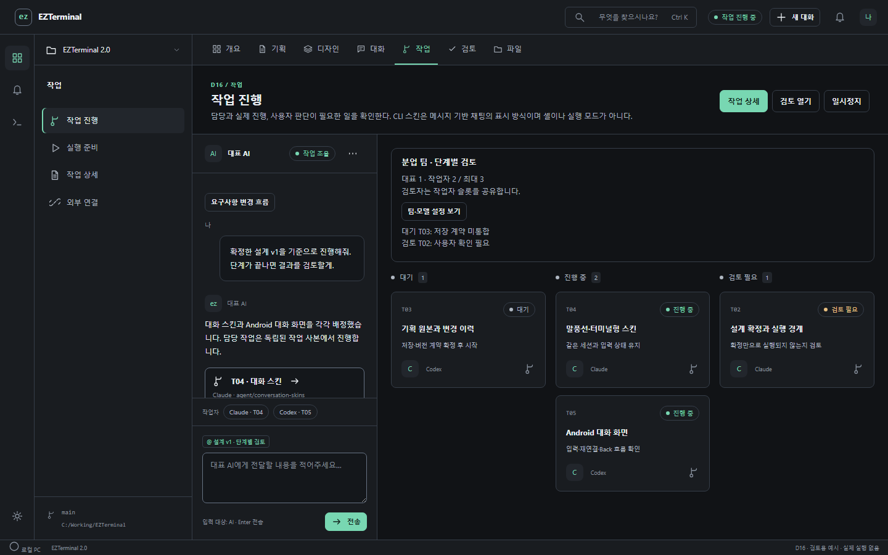
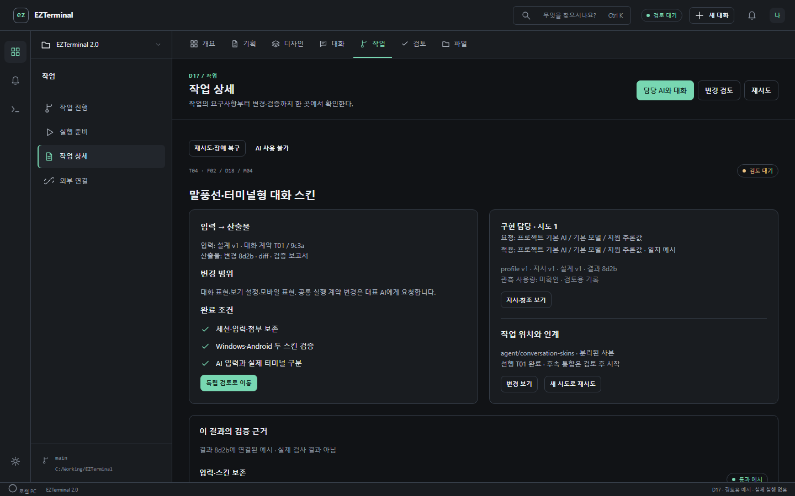
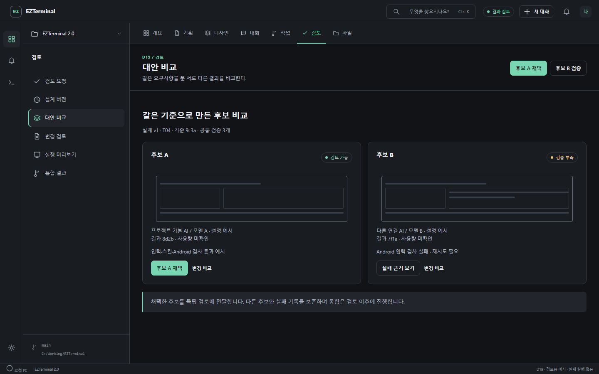
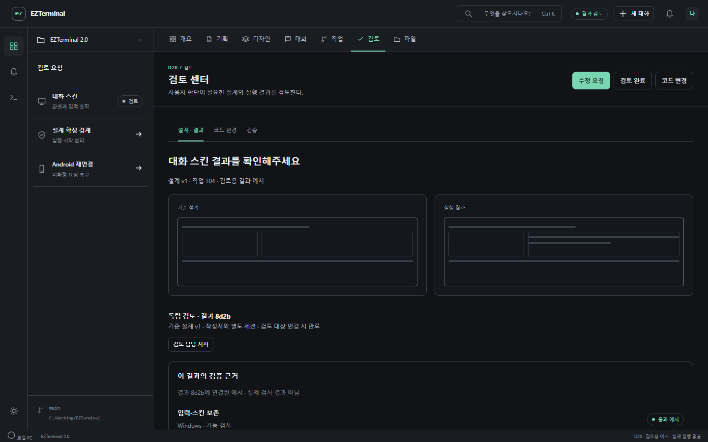
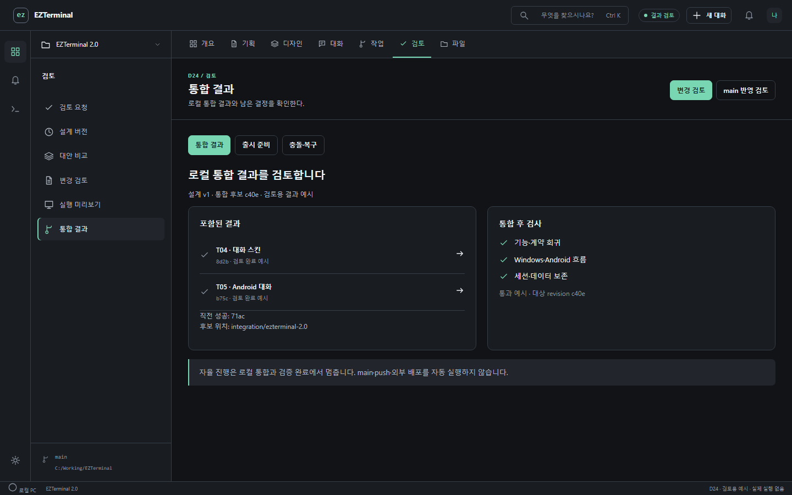
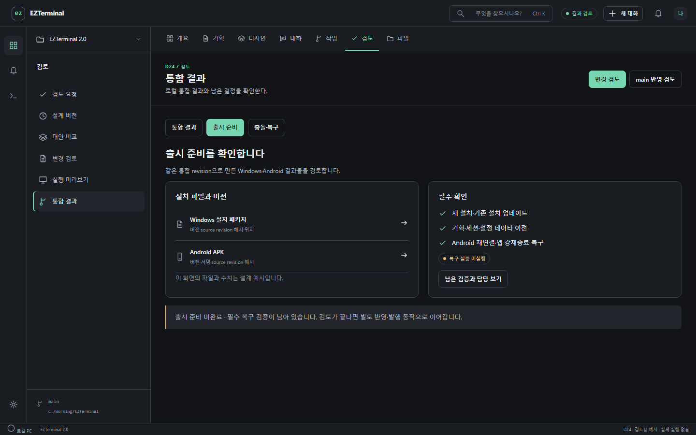

# 기획 이후 단계별 입력·산출물

[예상 화면과 함께 보기](index.html#delivery) · [계약·검증·복구 설계](DELIVERY-DESIGN.md)

r6 승인 기준에 포함한다. [승인 기록](APPROVAL.md). 아래 검증 결과는 실제로 실행된 기록이 아니다.

## L1 실행 준비

검토한 설계와 작업 범위, 팀 운영 방식, 진행 정책을 확인하고 실행 시작을 누릅니다.

- 담당: 대표 AI
- 입력: 확정 설계 ID·버전과 연결된 기능·화면 / 기준 commit·작업 위치·현재 사용자 변경 / 역할 프로필 버전·지원 모델·실행 권한
- 산출물: 변경 불가능한 Run 기준 / 작업별 지시·참조·모델 설정 초안 / 설정·권한·저장 공간·동시 실행 준비 결과
- 통과: 선택한 운영 방식의 참여 역할·참조·권한이 유효하고 사용자가 실행을 시작해야 합니다. 전체 시간 제한 없음, 검증 실패 추가 재시도 기본 2회.
- 실패·복귀: 미설정 모델은 D36에서 수정합니다. 오래된 설계·작업 기준은 D13에서 다시 확인합니다. 실패한 준비 점검은 작업자를 만들지 않습니다.
- 화면: [D15](index.html#screen/D15) · [M07](index.html#screen/M07)

## L2 작업 분해와 배정

대표 AI가 만든 작업의 입력·완료 조건·선행 작업을 확인하고 각 담당의 진행을 봅니다.

- 담당: 대표 AI
- 입력: 실행 범위와 역할별 설정 / 파일·계약 소유권과 선행 작업 / 단계별 검토 또는 자율 진행 정책
- 산출물: TaskDefinition과 의존 관계 / 담당 역할·변경 허용 범위·검증 계획 / 작업별 분리된 사본과 첫 실행 시도
- 통과: 순환 의존성이 없고 선행 산출물이 검토·통합되었으며 같은 쓰기 범위를 동시에 맡기지 않습니다.
- 실패·복귀: 계약 충돌은 대표 AI의 질문으로 남기고 관련 작업만 대기합니다. 일시정지는 새 배정을 멈추고 실행 중 작업의 종료 여부는 별도로 확인합니다.
- 화면: [D16](index.html#screen/D16) · [M07](index.html#screen/M07)

## L3 구현과 작업 인계

작업 상세에서 담당의 적용 지시·모델·변경·검증 근거를 보고 필요한 질문에 답합니다.

- 담당: 구현 담당
- 입력: 확정 TaskDefinition과 정확한 입력 revision / 허용 파일 범위·공유 인터페이스 / 프롬프트·참조·권한이 고정된 attempt
- 산출물: 산출물 revision·변경 파일·diff / 수용 조건별 검증 결과와 재현 방법 / 미해결 문제·한계·후속 작업 인계
- 통과: 작업자의 완료 보고는 검토 대기로만 이동합니다. 검증과 독립 검토가 끝나야 통합 후보가 됩니다.
- 실패·복귀: 검증 실패는 기본 2회 추가 수정·재검증 후 대기합니다. AI 연결·사용량 장애는 해당 작업을 보류하고 대체 AI 선택을 요청합니다. 불명확한 실행은 먼저 대조합니다.
- 화면: [D17](index.html#screen/D17) · [M07](index.html#screen/M07)

## L4 후보 비교와 선택

후보 비교 방식을 선택한 경우 같은 기준에서 나온 산출물과 근거를 비교합니다.

- 담당: 독립 검토 담당
- 입력: 같은 TaskDefinition·base revision·검증 기준 / 후보별 실제 적용 설정·결과 revision / 실패 후보를 포함한 시도 기록
- 산출물: 채택한 후보 ID와 이유 / 남겨 둔 다른 후보와 검증 부족 항목 / 독립 검토로 전달할 결과
- 통과: 필수 근거가 없는 후보는 채택할 수 없습니다. 채택은 통합이나 main 반영을 실행하지 않습니다.
- 실패·복귀: 후보 일부가 실패하면 실패를 표시하고 나머지는 비교 가능합니다. 기준이 다른 후보는 비교를 중지하고 같은 기준으로 다시 요청합니다.
- 화면: [D19](index.html#screen/D19) · [M08](index.html#screen/M08)

## L5 검증과 독립 검토

설계·코드 변경·실행 화면·검증 근거를 함께 보고 검토 완료 또는 수정 요청을 남깁니다.

- 담당: 독립 검토 담당
- 입력: 정확한 결과 revision과 baseline / 수용 조건별 명령·환경·결과·로그 / 작성자와 분리된 검토 세션
- 산출물: revision에 묶인 검토 결과 / 통과·실패·미실행이 구분된 Evidence 묶음 / 수정 요청과 재검토 대상
- 통과: 필수 검사와 Windows·Android 대응 검토가 통과해야 합니다. 미실행은 통과가 아니며 사용자 단계 검토가 필요한 경우 기다립니다.
- 실패·복귀: 검증 실패는 남은 재시도 내 L3으로 복귀합니다. 요구사항 변경은 영향 작업과 후속 의존 작업만 멈추고 새 초안·변경 계획 확인 후 재개합니다. 이전 검토와 근거는 보존합니다.
- 화면: [D20](index.html#screen/D20) · [M08](index.html#screen/M08)

## L6 로컬 통합과 재검증

검토된 결과를 로컬 통합 후보에 모으고 통합 후 검사와 실패 복구 지점을 확인합니다.

- 담당: 통합 담당
- 입력: 채택·검토 완료된 정확한 revision / 현재 통합 기준·직전 성공 지점 / 통합 순서와 통합 후 검사 목록
- 산출물: 통합 후보 revision·포함 작업 목록 / 통합 후 검증 근거 / 성공 지점 또는 실패·복구 기록
- 통과: 깨끗한 별도 통합 후보에서 검사 후 성공 지점으로 채택합니다. 자율 진행은 이 단계에서 종료합니다.
- 실패·복귀: 충돌·부분 실패는 성공으로 처리하지 않습니다. 후보를 격리하고 직전 성공 결과를 유지합니다. 수정된 범위와 의존 작업을 다시 검토·검증합니다.
- 화면: [D24](index.html#screen/D24) · [M08](index.html#screen/M08)

## L7 출시 준비와 인계

출시를 요청한 프로젝트는 통합 상세에서 패키지·설치·이전·복구 근거와 남은 결정을 확인합니다.

- 담당: 통합 담당
- 입력: 검증된 로컬 통합 revision / Windows·Android 패키지와 버전 정보 / 설치·업데이트·데이터 이전·복구 결과
- 산출물: 출시 준비 보고서와 파일 위치·해시 / 알려진 문제·설치와 복구 안내 / main 반영·외부 발행을 위한 검토 자료
- 통과: 요청한 플랫폼의 모든 필수 검증을 통과하고 결과물이 같은 기준 revision을 가리켜야 합니다. 실제 반영·발행은 사용자의 별도 동작입니다.
- 실패·복귀: 패키지·업데이트·이전이 실패하면 출시 준비 미완료로 표시합니다. 기존 설치와 백업을 보존하고 L3 또는 L6으로 돌아갑니다.
- 화면: [D24](index.html#screen/D24) · [M08](index.html#screen/M08)

