# 정보 구조와 사용자 흐름

[사용 흐름과 예상 화면 함께 보기](index.html#flows). 흐름을 선택하면 각 단계의 행동·예상 화면·변화·다음 조건을 함께 볼 수 있습니다. 이미지 확대에서 이전·다음 단계를 넘기거나 상세 시안과 와이어프레임을 비교할 수 있습니다.

아래 이미지는 기획 중인 화면의 예시 레이아웃입니다. 예시 데이터는 각 단계의 실행 결과를 증명하지 않습니다. 같은 화면을 재방문하는 경우에도 방문 목적과 다음 조건을 구분했습니다.

Windows 전역: 프로젝트 / 받은 요청 / 도구 / 설정. 프로젝트 영역은 상단에서 개요 / 기획 / 디자인 / 대화 / 작업 / 검토 / 파일로 전환합니다. 왼쪽에는 현재 영역의 목록 하나만 표시합니다.

Android: 프로젝트 / 대화 / 작업 / 터미널 / 더보기. PC 제어는 홈과 더보기에서 시작합니다.

기획·디자인은 프로젝트 원본을, 실제 실행은 Workspace·Session을 사용합니다. 기획의 정보 구조와 코드의 Project Map은 별도 도메인입니다.

## U01 아이디어에서 설계 확정까지

만들고 싶은 제품의 아이디어가 있고, 아직 프로젝트나 확정된 설계가 없는 상태에서 시작합니다.

[이 흐름을 화면으로 보기](index.html#flows?journey=U01)

[D01 프로젝트 홈](SCREENS.md#d01) → [D02 새 프로젝트 · 가져오기](SCREENS.md#d02) → [D05 PRD](SCREENS.md#d05) → [D06 기능명세](SCREENS.md#d06) → [D07 정보 구조](SCREENS.md#d07) → [D08 사용자 흐름](SCREENS.md#d08) → [D09 화면 목록](SCREENS.md#d09) → [D10 화면 편집](SCREENS.md#d10) → [D11 프로토타입](SCREENS.md#d11) → [D13 버전 · 설계 확정](SCREENS.md#d13)

- 완료: 확정본은 만들어지지만 코드 실행은 시작하지 않는다.
- 예외·복구: PRD 변경 → 연결 화면 검토 필요 → 수정 → 재검토 → 확정

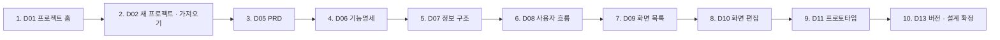

### 1. 아이디어로 시작하기

- **사용자 행동:** 홈에서 만들고 싶은 일을 설명하고 새 프로젝트를 선택합니다.
- **화면에서 확인할 변화:** 아이디어를 이어받을 프로젝트 생성 화면으로 이동합니다.
- **다음 조건·행동:** 프로젝트 이름과 작업 위치를 정합니다.
- **AI 역할:** AI 자동 실행 없음 · 사용자·호스트 동작

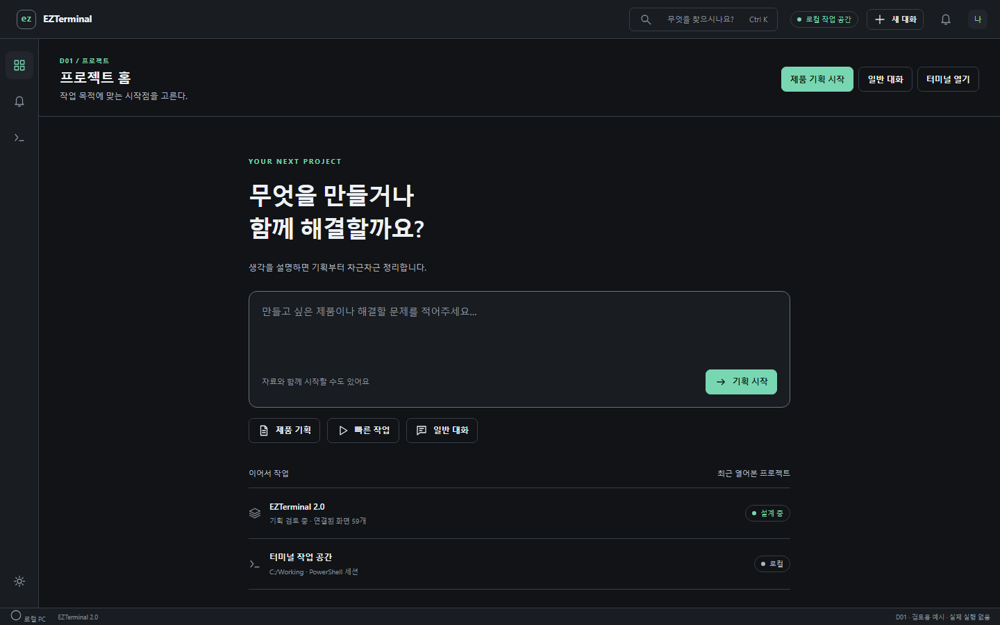

[와이어프레임](screens/wireframe/D01.png) · [화면 명세](SCREENS.md#d01) · [흐름의 이 단계 열기](index.html#flows?journey=U01&step=1)

### 2. 프로젝트의 작업 위치 정하기

- **사용자 행동:** 프로젝트 이름·폴더·시작 방식을 확인합니다.
- **화면에서 확인할 변화:** 기획 자료를 보관할 프로젝트와 첫 대화가 준비됩니다.
- **다음 조건·행동:** 아이디어를 PRD 초안으로 구체화합니다.
- **AI 역할:** AI 자동 실행 없음 · 사용자·호스트 동작

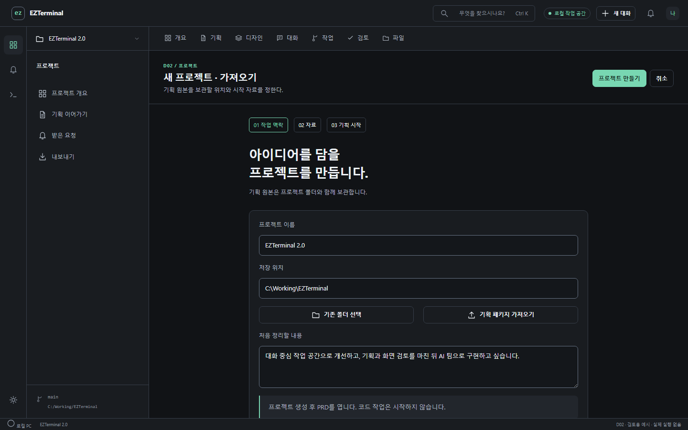

[와이어프레임](screens/wireframe/D02.png) · [화면 명세](SCREENS.md#d02) · [흐름의 이 단계 열기](index.html#flows?journey=U01&step=2)

### 3. 대화하며 제품 기획 다듬기

- **사용자 행동:** AI와 목표·사용자·범위를 정하고, 옆의 PRD를 직접 고칩니다.
- **화면에서 확인할 변화:** 대화와 문서가 같은 맥락에 놓이며 수정 이력이 남습니다.
- **다음 조건·행동:** 검토할 기능을 PRD에서 연결합니다.
- **AI 역할:** [기획 담당](AI-PROFILES.md#planning) · 요청·허용된 배정 시 적용

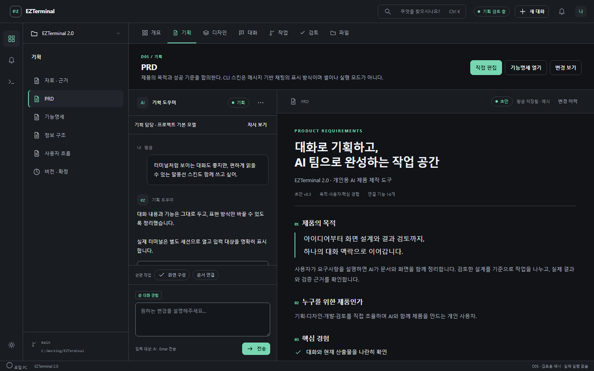

[와이어프레임](screens/wireframe/D05.png) · [화면 명세](SCREENS.md#d05) · [흐름의 이 단계 열기](index.html#flows?journey=U01&step=3)

### 4. 기능의 범위와 완료 조건 정하기

- **사용자 행동:** 기능 목록에서 항목을 선택하고 동작·수용 기준을 검토합니다.
- **화면에서 확인할 변화:** 어떤 기능을 만들고 무엇을 확인할지 정리됩니다.
- **다음 조건·행동:** 기능이 배치될 메뉴와 화면 관계를 확인합니다.
- **AI 역할:** [기획 담당](AI-PROFILES.md#planning) · 요청·허용된 배정 시 적용

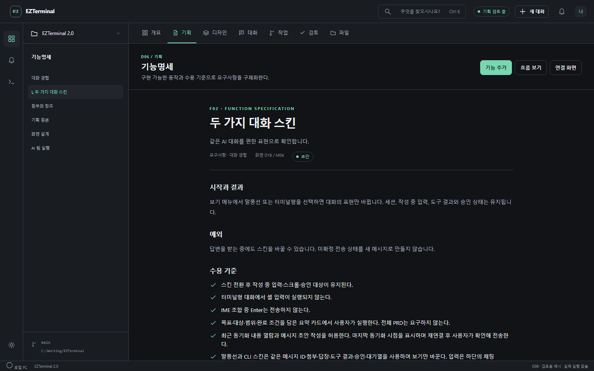

[와이어프레임](screens/wireframe/D06.png) · [화면 명세](SCREENS.md#d06) · [흐름의 이 단계 열기](index.html#flows?journey=U01&step=4)

### 5. 화면의 정보 구조 정하기

- **사용자 행동:** 프로젝트의 기획·디자인·대화·작업 영역과 화면 연결을 조정합니다.
- **화면에서 확인할 변화:** 화면이 어느 영역에 속하는지 한눈에 보입니다.
- **다음 조건·행동:** 사용자가 실제로 이동할 순서를 정합니다.
- **AI 역할:** [흐름 설계 담당](AI-PROFILES.md#ux) · 요청·허용된 배정 시 적용

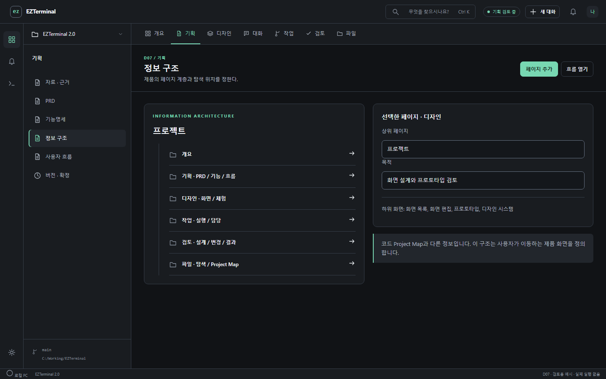

[와이어프레임](screens/wireframe/D07.png) · [화면 명세](SCREENS.md#d07) · [흐름의 이 단계 열기](index.html#flows?journey=U01&step=5)

### 6. 사용 흐름과 복구 경로 확인하기

- **사용자 행동:** 정상 흐름에 취소·실패·복귀 경로를 연결합니다.
- **화면에서 확인할 변화:** 화면 사이의 진입 조건과 다음 행동이 정리됩니다.
- **다음 조건·행동:** 각 단계에 대응하는 화면 시안을 봅니다.
- **AI 역할:** [흐름 설계 담당](AI-PROFILES.md#ux) · 요청·허용된 배정 시 적용

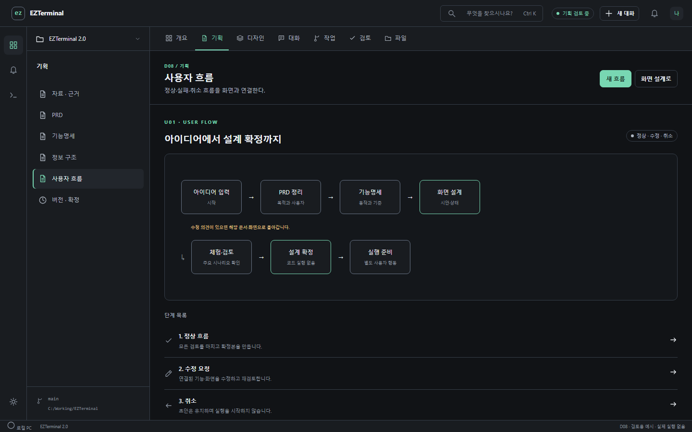

[와이어프레임](screens/wireframe/D08.png) · [화면 명세](SCREENS.md#d08) · [흐름의 이 단계 열기](index.html#flows?journey=U01&step=6)

### 7. 전체 화면에서 빠진 화면 찾기

- **사용자 행동:** Windows·Android 시안을 모아 보고 편집할 화면을 선택합니다.
- **화면에서 확인할 변화:** 아직 검토하지 않은 화면과 연결된 기능이 드러납니다.
- **다음 조건·행동:** 선택한 화면의 배치와 문구를 다듬습니다.
- **AI 역할:** [화면 설계 담당](AI-PROFILES.md#designer) · 요청·허용된 배정 시 적용

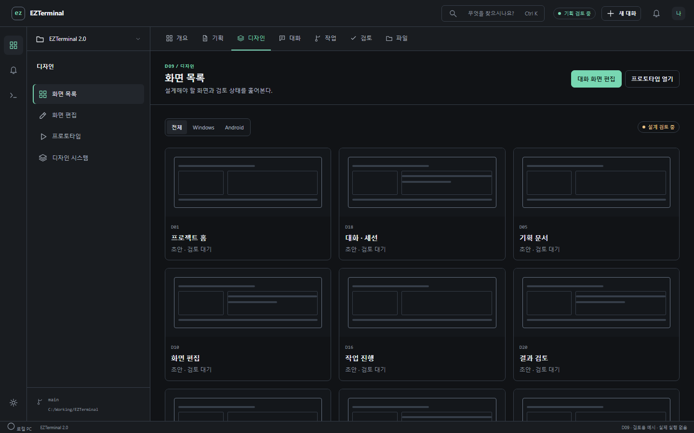

[와이어프레임](screens/wireframe/D09.png) · [화면 명세](SCREENS.md#d09) · [흐름의 이 단계 열기](index.html#flows?journey=U01&step=7)

### 8. 화면을 직접 고치거나 AI에 요청하기

- **사용자 행동:** 요소를 선택해 속성을 바꾸거나, 선택한 부분을 대화로 수정 요청합니다.
- **화면에서 확인할 변화:** 선택 요소와 수정 맥락이 유지된 화면 초안이 생깁니다.
- **다음 조건·행동:** 수정한 화면 사이의 이동을 체험합니다.
- **AI 역할:** [화면 설계 담당](AI-PROFILES.md#designer) · 요청·허용된 배정 시 적용

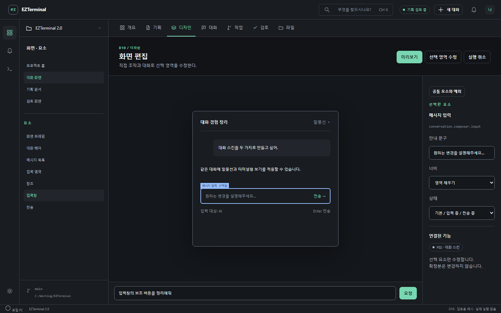

[와이어프레임](screens/wireframe/D10.png) · [화면 명세](SCREENS.md#d10) · [흐름의 이 단계 열기](index.html#flows?journey=U01&step=8)

### 9. 사용자처럼 화면 이동해 보기

- **사용자 행동:** 프로토타입의 버튼을 눌러 주요 사용 흐름을 따라갑니다.
- **화면에서 확인할 변화:** 막히는 단계와 어색한 전환을 찾아 검토 의견으로 남깁니다.
- **다음 조건·행동:** 의견을 해결한 뒤 설계 확정 화면으로 갑니다.
- **AI 역할:** [독립 검토 담당](AI-PROFILES.md#reviewer) · 요청·허용된 배정 시 적용

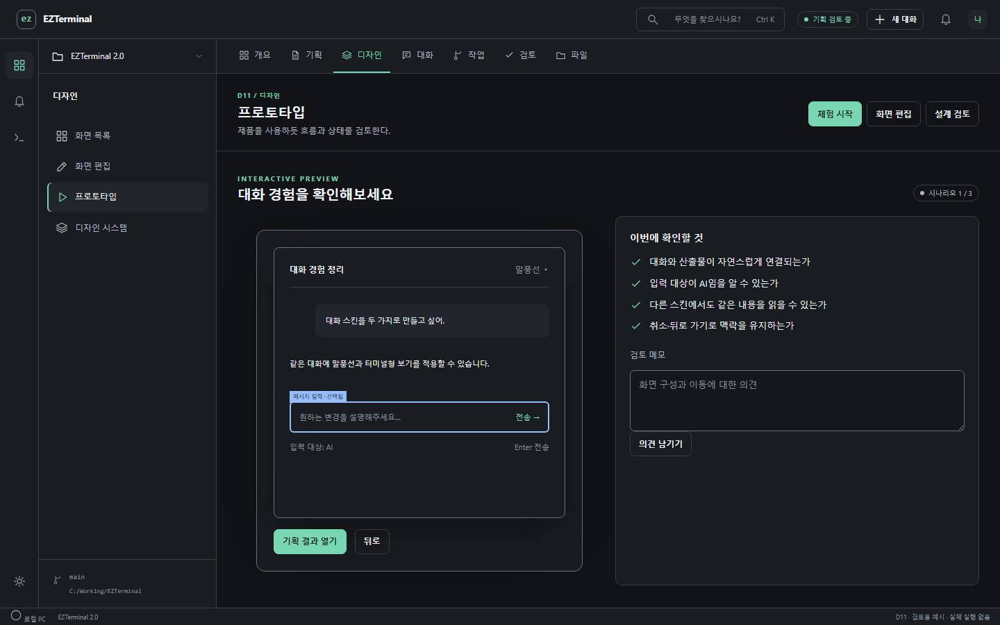

[와이어프레임](screens/wireframe/D11.png) · [화면 명세](SCREENS.md#d11) · [흐름의 이 단계 열기](index.html#flows?journey=U01&step=9)

### 10. 검토한 설계를 기준으로 남기기

- **사용자 행동:** 미해결 검토를 확인하고 설계 버전을 확정합니다.
- **화면에서 확인할 변화:** 변하지 않는 기준 설계가 남습니다. 이 동작만으로 구현이 시작되지는 않습니다.
- **다음 조건·행동:** 구현을 시작하려면 별도의 실행 준비 흐름 U02로 이동합니다.
- **AI 역할:** AI 자동 실행 없음 · 사용자·호스트 동작

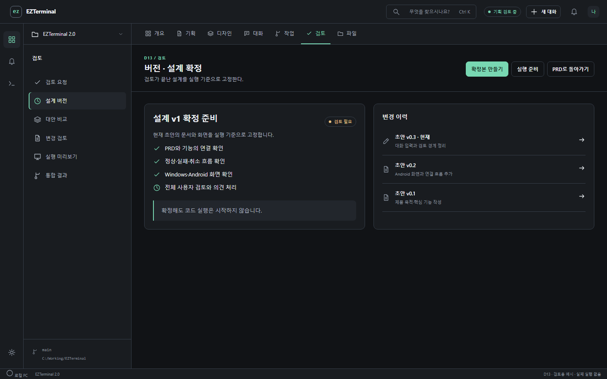

[와이어프레임](screens/wireframe/D13.png) · [화면 명세](SCREENS.md#d13) · [흐름의 이 단계 열기](index.html#flows?journey=U01&step=10)

### 예외·복구 — 수정이 남아 있으면 설계 확정을 보류합니다

- 행동: 변경된 PRD에서 연결된 기능·화면으로 돌아가 영향을 검토합니다.
- 결과: 수정과 재검토를 마친 뒤 10단계에서 다시 확정합니다.
- 복귀 지점: 10단계. 실제 복귀는 오류가 발생하기 전 작업 위치를 우선합니다.

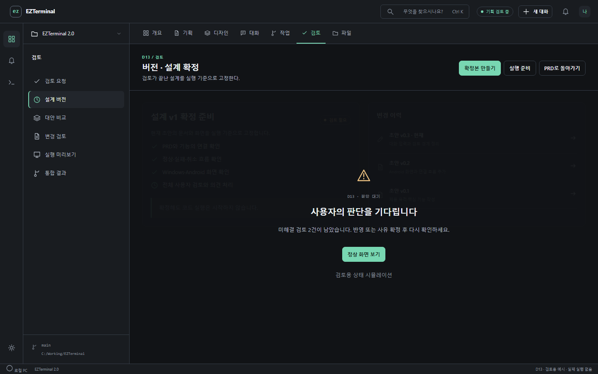

[복구 화면 체험](index.html#render/D13?state=blocked&interactive=1)

## U02 검토된 설계로 AI 팀 실행

사용자가 기획과 화면을 검토하고 기준 설계를 확정한 뒤, 구현을 시작하려는 상황입니다.

[이 흐름을 화면으로 보기](index.html#flows?journey=U02)

[D13 버전 · 설계 확정](SCREENS.md#d13) → [D15 실행 준비](SCREENS.md#d15) → [D16 작업 진행](SCREENS.md#d16) → [D17 작업 상세](SCREENS.md#d17) → [D20 검토 센터](SCREENS.md#d20) → [D22 변경 검토](SCREENS.md#d22) → [D23 실행 미리보기](SCREENS.md#d23) → [D24 통합 결과](SCREENS.md#d24)

- 완료: 검증된 결과가 로컬 통합 브랜치에 모인다.
- 예외·복구: 검증 실패 → D17 수정 요청 → 새 검증 → D20 재검토

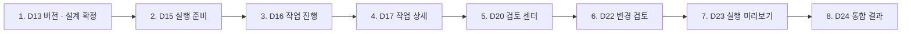

### 1. 구현에 사용할 설계 버전 확인하기

- **사용자 행동:** 확정된 설계와 포함된 화면·기능의 범위를 확인합니다.
- **화면에서 확인할 변화:** AI 작업이 참조할 기준이 정해집니다.
- **다음 조건·행동:** 실행 준비에서 작업 위치와 담당을 설정합니다.
- **AI 역할:** AI 자동 실행 없음 · 사용자·호스트 동작

[와이어프레임](screens/wireframe/D13.png) · [화면 명세](SCREENS.md#d13) · [흐름의 이 단계 열기](index.html#flows?journey=U02&step=1)

### 2. AI 팀과 검토 방식 정하기

- **사용자 행동:** Workspace·대표 AI·작업자·검토 지점·권한을 확인하고 실행을 명시적으로 시작합니다.
- **화면에서 확인할 변화:** 설계 기준과 작업 범위가 실행에 연결됩니다.
- **다음 조건·행동:** 작업 보드에서 배정 결과를 확인합니다.
- **AI 역할:** [대표 AI](AI-PROFILES.md#coordinator) · 요청·허용된 배정 시 적용

[와이어프레임](screens/wireframe/D15.png) · [화면 명세](SCREENS.md#d15) · [흐름의 이 단계 열기](index.html#flows?journey=U02&step=2)

### 3. 진행 상황에서 필요한 작업만 열기

- **사용자 행동:** 대표 AI의 설명과 작업별 진행·검토 대기 상태를 봅니다.
- **화면에서 확인할 변화:** 어느 작업이 진행 중이고 어디에 판단이 필요한지 알 수 있습니다.
- **다음 조건·행동:** 작업 카드를 열어 결과와 근거를 확인합니다.
- **AI 역할:** [대표 AI](AI-PROFILES.md#coordinator) · 현재 실행·세션 유지

[와이어프레임](screens/wireframe/D16.png) · [화면 명세](SCREENS.md#d16) · [흐름의 이 단계 열기](index.html#flows?journey=U02&step=3)

### 4. 담당 작업의 결과와 근거 확인하기

- **사용자 행동:** 담당 AI·산출물·검증 결과·실패 원인을 살펴봅니다.
- **화면에서 확인할 변화:** 검토 가능한 결과가 작업 단위로 묶입니다.
- **다음 조건·행동:** 검토 요청을 열어 수용 기준과 비교합니다.
- **AI 역할:** [구현 담당](AI-PROFILES.md#builder) · 현재 실행·세션 유지

[와이어프레임](screens/wireframe/D17.png) · [화면 명세](SCREENS.md#d17) · [흐름의 이 단계 열기](index.html#flows?journey=U02&step=4)

### 5. 수용 기준으로 결과 검토하기

- **사용자 행동:** 설계 기준과 결과를 비교하고 의견을 남깁니다.
- **화면에서 확인할 변화:** 추가로 볼 코드·실행 화면과 보완할 사항이 정리됩니다.
- **다음 조건·행동:** 먼저 변경 코드를 확인합니다.
- **AI 역할:** [독립 검토 담당](AI-PROFILES.md#reviewer) · 요청·허용된 배정 시 적용

[와이어프레임](screens/wireframe/D20.png) · [화면 명세](SCREENS.md#d20) · [흐름의 이 단계 열기](index.html#flows?journey=U02&step=5)

### 6. 변경된 코드 확인하기

- **사용자 행동:** 파일별 추가·삭제와 수정 이유를 확인합니다.
- **화면에서 확인할 변화:** 설계 범위 밖의 변경이나 누락을 검토할 수 있습니다.
- **다음 조건·행동:** 실행 화면에서도 동작과 배치를 확인합니다.
- **AI 역할:** [독립 검토 담당](AI-PROFILES.md#reviewer) · 요청·허용된 배정 시 적용

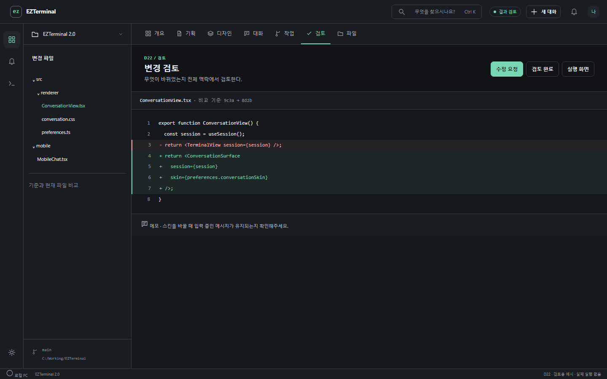

[와이어프레임](screens/wireframe/D22.png) · [화면 명세](SCREENS.md#d22) · [흐름의 이 단계 열기](index.html#flows?journey=U02&step=6)

### 7. 실행 화면으로 결과 확인하기

- **사용자 행동:** 미리보기에서 구현 결과를 보고 필요하면 요소를 지정해 수정 요청합니다.
- **화면에서 확인할 변화:** 코드와 화면을 함께 검토한 근거가 남습니다.
- **다음 조건·행동:** 검토와 검증이 끝난 결과를 로컬 통합 대상으로 선택합니다.
- **AI 역할:** [독립 검토 담당](AI-PROFILES.md#reviewer) · 요청·허용된 배정 시 적용

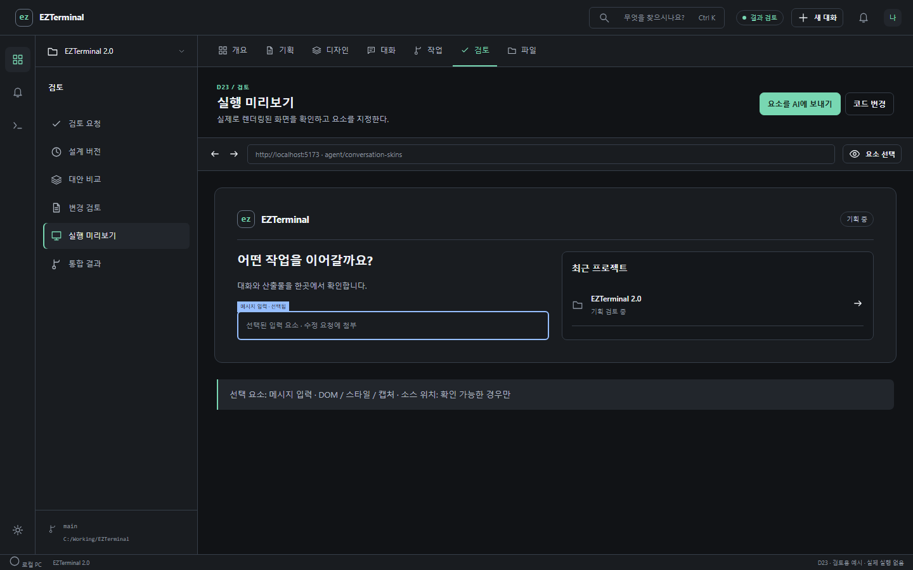

[와이어프레임](screens/wireframe/D23.png) · [화면 명세](SCREENS.md#d23) · [흐름의 이 단계 열기](index.html#flows?journey=U02&step=7)

### 8. 검증된 작업을 로컬에 통합하기

- **사용자 행동:** 통합 대상·충돌·검증 결과를 확인합니다.
- **화면에서 확인할 변화:** 완료한 작업이 로컬 통합 브랜치에 모입니다.
- **다음 조건·행동:** main 병합·push·배포는 별도의 명시적 작업으로 남습니다.
- **AI 역할:** [통합 담당](AI-PROFILES.md#integrator) · 요청·허용된 배정 시 적용

[와이어프레임](screens/wireframe/D24.png) · [화면 명세](SCREENS.md#d24) · [흐름의 이 단계 열기](index.html#flows?journey=U02&step=8)

### 예외·복구 — 추가 수정·재검증 소진 후 사용자 판단

- 행동: 최초 실패와 추가 2회 결과·남은 문제를 확인합니다.
- 결과: 자동 재시도를 멈추고 사용자의 수정 지시·추가 시도·취소 선택을 기다립니다.
- 복귀 지점: 5단계. 실제 복귀는 오류가 발생하기 전 작업 위치를 우선합니다.

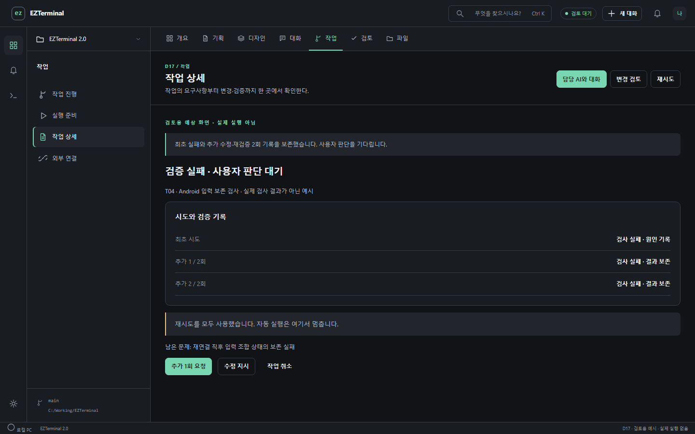

[복구 화면 체험](index.html#render/D17?state=exhausted&interactive=1)

## U03 빠른 수정과 대화 스킨

전체 기획 절차 없이, 범위가 정해진 작은 수정이나 일반 대화를 바로 시작합니다.

[이 흐름을 화면으로 보기](index.html#flows?journey=U03)

[D01 프로젝트 홈](SCREENS.md#d01) → [D18 대화 · 세션](SCREENS.md#d18) → [D18 대화 · 세션](SCREENS.md#d18) → [D21 파일 편집](SCREENS.md#d21) → [D22 변경 검토](SCREENS.md#d22)

- 완료: 전체 기획 절차 없이 범위가 정해진 수정 결과를 검토한다.
- 예외·복구: 저장 충돌 → D21 비교 → 수정 보존 → 재저장

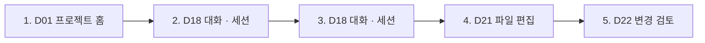

### 1. 바로 대화 시작하기

- **사용자 행동:** 홈에서 빠른 작업 또는 대화를 선택합니다.
- **화면에서 확인할 변화:** 기획 문서 작성 없이 대화로 진입합니다.
- **다음 조건·행동:** 대화에서 수정 범위를 설명합니다.
- **AI 역할:** AI 자동 실행 없음 · 사용자·호스트 동작

[와이어프레임](screens/wireframe/D01.png) · [화면 명세](SCREENS.md#d01) · [흐름의 이 단계 열기](index.html#flows?journey=U03&step=1)

### 2. 요청과 실행 요약 카드 확인하기

- **사용자 행동:** 스킨을 전환해도 유지되는 대화에서 목표·대상·범위·완료 조건을 확인합니다.
- **화면에서 확인할 변화:** 실행 전 요약 카드가 나타납니다. 실제 수정은 시작하지 않았습니다.
- **다음 조건·행동:** 카드에서 실행을 누릅니다.
- **AI 역할:** [일반 대화](AI-PROFILES.md#general) · 요청·허용된 배정 시 적용

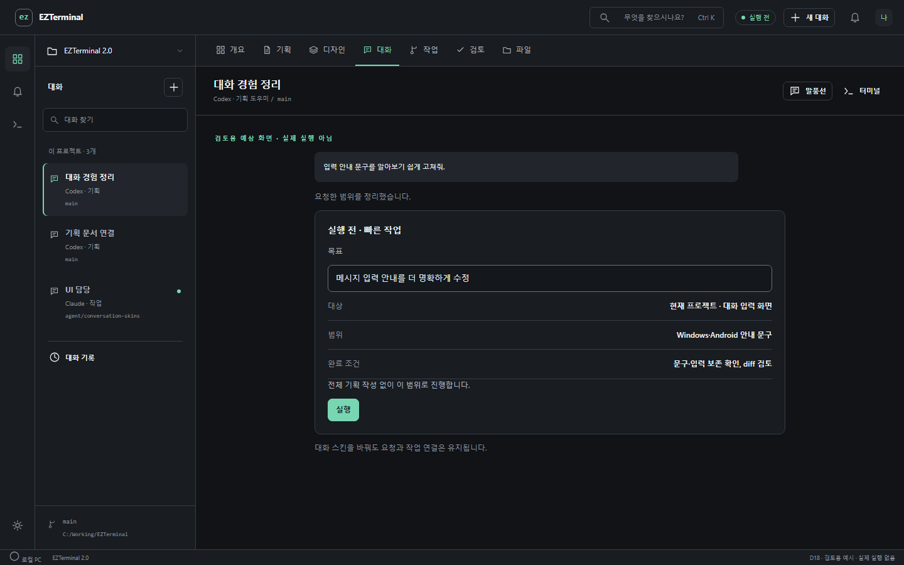

[와이어프레임](screens/policies/quick-ready-wireframe.png) · [화면 명세](SCREENS.md#d18) · [흐름의 이 단계 열기](index.html#flows?journey=U03&step=2)

### 3. 실행을 시작하고 작업 추적하기

- **사용자 행동:** 검토한 요약 카드의 실행을 누릅니다.
- **화면에서 확인할 변화:** 같은 대화에 작업 ID와 실행 기록이 연결됩니다.
- **다음 조건·행동:** 작업 결과를 파일에서 검토합니다.
- **AI 역할:** [구현 담당](AI-PROFILES.md#builder) · 현재 실행·세션 유지

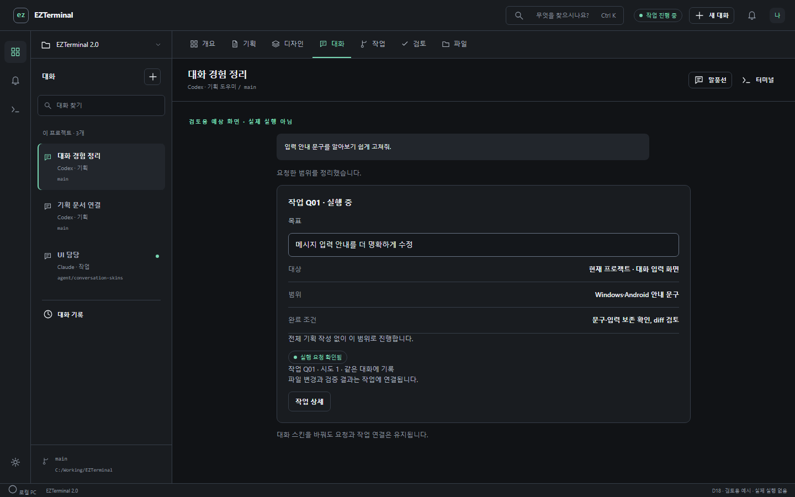

[와이어프레임](screens/policies/quick-running-wireframe.png) · [화면 명세](SCREENS.md#d18) · [흐름의 이 단계 열기](index.html#flows?journey=U03&step=3)

### 4. 파일을 확인하고 필요한 부분 고치기

- **사용자 행동:** 왼쪽 파일 목록에서 결과를 선택하고 내용을 편집합니다.
- **화면에서 확인할 변화:** 직접 수정한 내용과 AI 변경을 함께 확인할 수 있습니다.
- **다음 조건·행동:** 저장한 변경을 비교 화면에서 검토합니다.
- **AI 역할:** AI 자동 실행 없음 · 사용자·호스트 동작

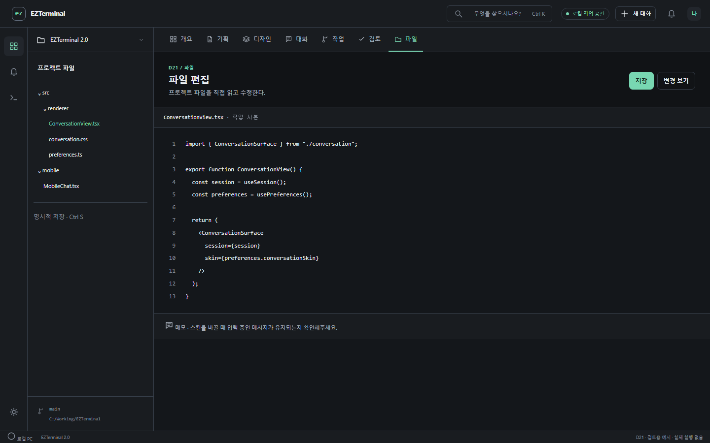

[와이어프레임](screens/wireframe/D21.png) · [화면 명세](SCREENS.md#d21) · [흐름의 이 단계 열기](index.html#flows?journey=U03&step=4)

### 5. 작은 수정도 변경 결과 확인하기

- **사용자 행동:** 수정된 파일과 차이를 비교하고 검증 근거를 살펴봅니다.
- **화면에서 확인할 변화:** 요청 범위에 맞게 고쳐졌는지 판단할 수 있습니다.
- **다음 조건·행동:** 보완이 필요하면 같은 대화에 의견을 남깁니다.
- **AI 역할:** [독립 검토 담당](AI-PROFILES.md#reviewer) · 요청·허용된 배정 시 적용

[와이어프레임](screens/wireframe/D22.png) · [화면 명세](SCREENS.md#d22) · [흐름의 이 단계 열기](index.html#flows?journey=U03&step=5)

### 예외·복구 — 외부 변경과 충돌하면 먼저 비교합니다

- 행동: 작성 중 내용을 유지한 채 디스크의 최신 파일과 비교합니다.
- 결과: 남길 내용을 결정한 뒤 저장하고 변경 검토로 돌아갑니다.
- 복귀 지점: 4단계. 실제 복귀는 오류가 발생하기 전 작업 위치를 우선합니다.

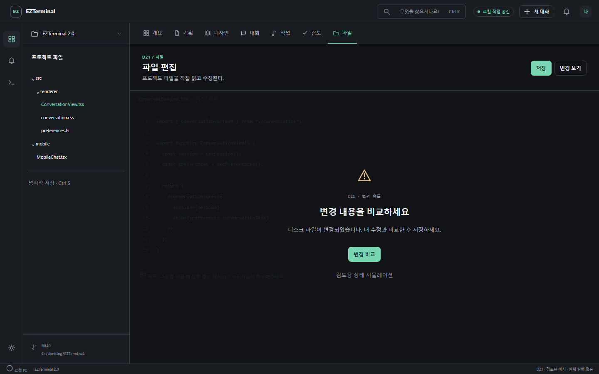

[복구 화면 체험](index.html#render/D21?state=conflict&interactive=1)

## U04 Android에서 진행 확인과 검토

PC에서 진행 중인 프로젝트를 Android에서 확인하고 검토 의견을 남깁니다.

[이 흐름을 화면으로 보기](index.html#flows?journey=U04)

[M01 연결 · QR](SCREENS.md#m01) → [M02 프로젝트 홈](SCREENS.md#m02) → [M03 프로젝트 상세](SCREENS.md#m03) → [M07 작업](SCREENS.md#m07) → [M08 검토 · 받은 요청](SCREENS.md#m08) → [M04 대화](SCREENS.md#m04)

- 완료: PC와 같은 실행에 의견을 남기고 대화를 이어간다.
- 예외·복구: 연결 끊김 → M16 → 상태 대조 → 원래 작업 복원

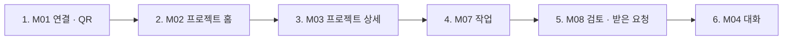

### 1. 작업 중인 PC 연결하기

- **사용자 행동:** 연결할 PC를 선택하고 페어링 상태를 확인합니다.
- **화면에서 확인할 변화:** 같은 프로젝트와 실행 상태에 접근할 준비가 됩니다.
- **다음 조건·행동:** 홈에서 이어 볼 프로젝트를 찾습니다.
- **AI 역할:** AI 자동 실행 없음 · 사용자·호스트 동작

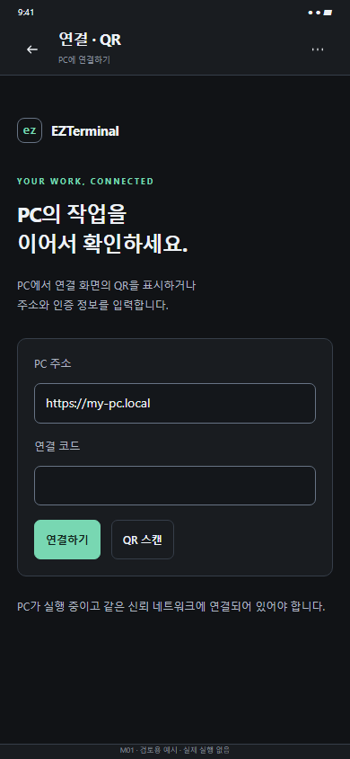

[와이어프레임](screens/wireframe/M01.png) · [화면 명세](SCREENS.md#m01) · [흐름의 이 단계 열기](index.html#flows?journey=U04&step=1)

### 2. 지금 필요한 요청 찾기

- **사용자 행동:** 진행 중 작업과 검토 대기 알림을 확인합니다.
- **화면에서 확인할 변화:** 우선 확인할 프로젝트를 선택할 수 있습니다.
- **다음 조건·행동:** 프로젝트 요약을 엽니다.
- **AI 역할:** AI 자동 실행 없음 · 사용자·호스트 동작

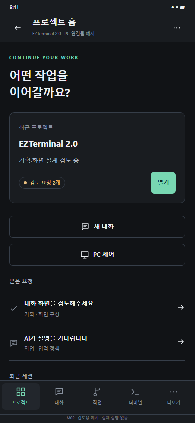

[와이어프레임](screens/wireframe/M02.png) · [화면 명세](SCREENS.md#m02) · [흐름의 이 단계 열기](index.html#flows?journey=U04&step=2)

### 3. 프로젝트 맥락 확인하기

- **사용자 행동:** 기획·대화·진행 상황을 요약에서 확인합니다.
- **화면에서 확인할 변화:** PC에서 하던 작업의 현재 위치를 파악합니다.
- **다음 조건·행동:** 작업 목록에서 검토가 필요한 항목을 찾습니다.
- **AI 역할:** AI 자동 실행 없음 · 사용자·호스트 동작

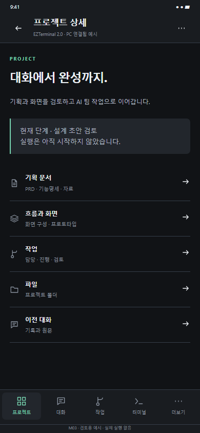

[와이어프레임](screens/wireframe/M03.png) · [화면 명세](SCREENS.md#m03) · [흐름의 이 단계 열기](index.html#flows?journey=U04&step=3)

### 4. 진행 중인 작업 선택하기

- **사용자 행동:** 작업 상태와 담당을 보고 검토 대기 작업을 엽니다.
- **화면에서 확인할 변화:** 모바일에서도 작업 단위로 근거를 살펴볼 수 있습니다.
- **다음 조건·행동:** 검토 화면에서 결과와 조건을 비교합니다.
- **AI 역할:** [대표 AI](AI-PROFILES.md#coordinator) · 현재 실행·세션 유지

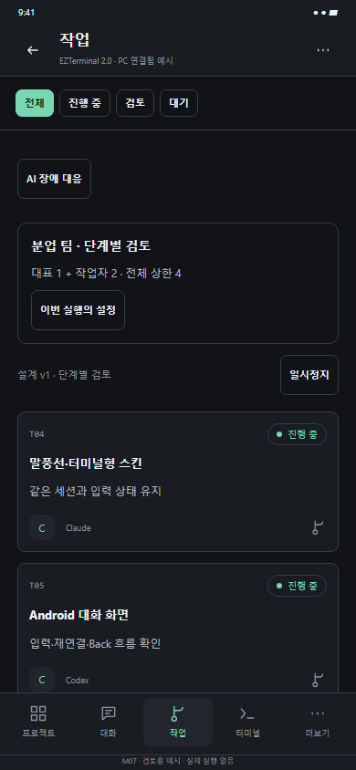

[와이어프레임](screens/wireframe/M07.png) · [화면 명세](SCREENS.md#m07) · [흐름의 이 단계 열기](index.html#flows?journey=U04&step=4)

### 5. 결과를 읽고 의견 남기기

- **사용자 행동:** 변경 요약·수용 조건을 확인하고 승인 또는 보완 의견을 남깁니다.
- **화면에서 확인할 변화:** 같은 PC 실행에 검토 기록이 연결됩니다.
- **다음 조건·행동:** 추가 설명이 필요하면 연결된 대화를 엽니다.
- **AI 역할:** [독립 검토 담당](AI-PROFILES.md#reviewer) · 요청·허용된 배정 시 적용

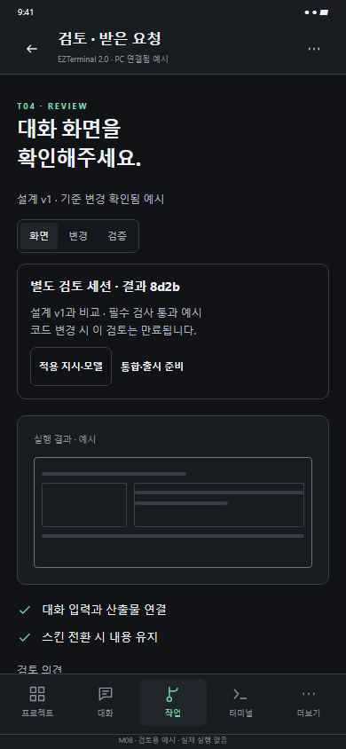

[와이어프레임](screens/wireframe/M08.png) · [화면 명세](SCREENS.md#m08) · [흐름의 이 단계 열기](index.html#flows?journey=U04&step=5)

### 6. PC에서 하던 대화 이어가기

- **사용자 행동:** 동일 세션에서 의견을 설명하고 후속 요청을 보냅니다.
- **화면에서 확인할 변화:** 검토와 대화가 같은 작업 맥락에 남습니다.
- **다음 조건·행동:** PC로 돌아가도 같은 실행과 대화를 이어갑니다.
- **AI 역할:** [일반 대화](AI-PROFILES.md#general) · 현재 실행·세션 유지

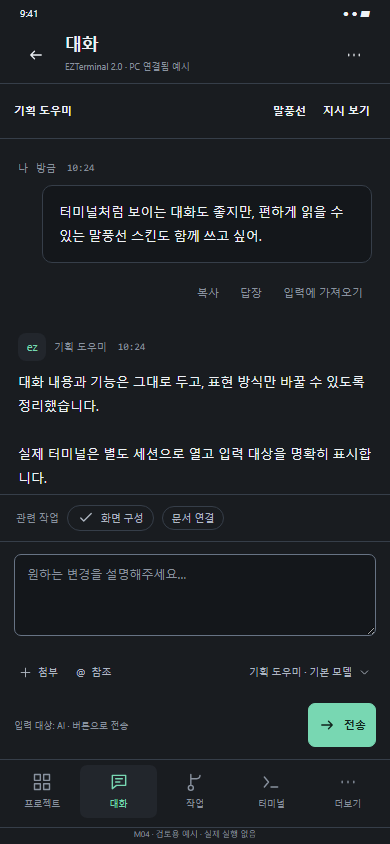

[와이어프레임](screens/wireframe/M04.png) · [화면 명세](SCREENS.md#m04) · [흐름의 이 단계 열기](index.html#flows?journey=U04&step=6)

### 예외·복구 — 끊긴 동안의 상태를 확인하고 복귀합니다

- 행동: PC와 네트워크 상태를 확인하고 재연결합니다.
- 결과: 서버의 최신 실행 상태와 대조한 뒤 원래 보던 작업을 복원합니다.
- 복귀 지점: 4단계. 실제 복귀는 오류가 발생하기 전 작업 위치를 우선합니다.

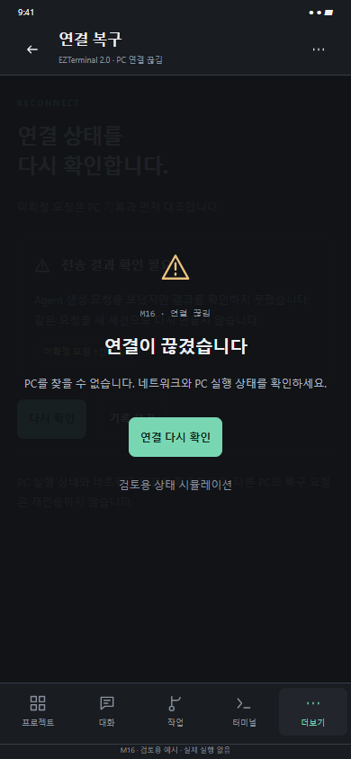

[복구 화면 체험](index.html#render/M16?state=offline&interactive=1)

## U05 실행 화면의 요소를 지정해 수정

구현된 화면을 보다가 고치고 싶은 요소를 발견한 상황입니다. 마지막 단계에서 같은 화면을 다시 확인합니다.

[이 흐름을 화면으로 보기](index.html#flows?journey=U05)

[D23 실행 미리보기](SCREENS.md#d23) → [D18 대화 · 세션](SCREENS.md#d18) → [D17 작업 상세](SCREENS.md#d17) → [D22 변경 검토](SCREENS.md#d22) → [D23 실행 미리보기](SCREENS.md#d23)

- 완료: 선택한 요소의 맥락이 수정 요청과 변경 검토에 남는다.
- 예외·복구: source map 없음 → 출처 미확인 표시 → DOM·캡처로 요청

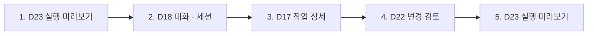

### 1. 실행 화면에서 수정할 요소 선택하기

- **사용자 행동:** 미리보기에서 요소를 선택하고 수정 요청을 작성합니다.
- **화면에서 확인할 변화:** 요소의 DOM·스타일·캡처와 확인 가능한 소스 위치가 요청에 묶입니다.
- **다음 조건·행동:** 이 맥락을 대화로 전달합니다.
- **AI 역할:** AI 자동 실행 없음 · 사용자·호스트 동작

[와이어프레임](screens/wireframe/D23.png) · [화면 명세](SCREENS.md#d23) · [흐름의 이 단계 열기](index.html#flows?journey=U05&step=1)

### 2. 선택한 요소를 맥락으로 대화하기

- **사용자 행동:** 첨부된 요소와 캡처를 확인하고 원하는 변경을 설명합니다.
- **화면에서 확인할 변화:** 무엇을 왜 고치는지 작업 요청에 남습니다.
- **다음 조건·행동:** 배정된 작업에서 수정 진행을 확인합니다.
- **AI 역할:** [구현 담당](AI-PROFILES.md#builder) · 요청·허용된 배정 시 적용

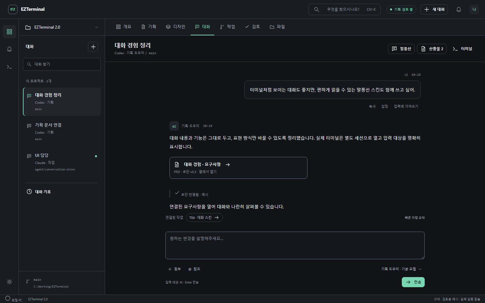

[와이어프레임](screens/wireframe/D18.png) · [화면 명세](SCREENS.md#d18) · [흐름의 이 단계 열기](index.html#flows?journey=U05&step=2)

### 3. 수정 작업과 검증 확인하기

- **사용자 행동:** 담당 AI의 진행과 결과·검증 근거를 확인합니다.
- **화면에서 확인할 변화:** 요소 선택에서 시작한 요청이 작업과 연결됩니다.
- **다음 조건·행동:** 완료한 변경 코드를 검토합니다.
- **AI 역할:** [구현 담당](AI-PROFILES.md#builder) · 현재 실행·세션 유지

[와이어프레임](screens/wireframe/D17.png) · [화면 명세](SCREENS.md#d17) · [흐름의 이 단계 열기](index.html#flows?journey=U05&step=3)

### 4. 요청과 코드 변경 비교하기

- **사용자 행동:** 해당 요소와 관련된 파일 차이를 확인합니다.
- **화면에서 확인할 변화:** 원래 요청과 변경 범위의 일치 여부를 판단합니다.
- **다음 조건·행동:** 처음 선택한 실행 화면으로 다시 돌아갑니다.
- **AI 역할:** [독립 검토 담당](AI-PROFILES.md#reviewer) · 요청·허용된 배정 시 적용

[와이어프레임](screens/wireframe/D22.png) · [화면 명세](SCREENS.md#d22) · [흐름의 이 단계 열기](index.html#flows?journey=U05&step=4)

### 5. 같은 화면에서 수정 결과 다시 보기

- **사용자 행동:** 처음 지정한 요소가 의도대로 바뀌었는지 확인합니다.
- **화면에서 확인할 변화:** 요소 선택 → 요청 → 수정 → 결과 확인이 한 흐름으로 이어집니다.
- **다음 조건·행동:** 추가 수정이 있으면 요소를 다시 선택해 같은 흐름을 반복합니다.
- **AI 역할:** AI 자동 실행 없음 · 사용자·호스트 동작

[와이어프레임](screens/wireframe/D23.png) · [화면 명세](SCREENS.md#d23) · [흐름의 이 단계 열기](index.html#flows?journey=U05&step=5)

### 예외·복구 — 소스 위치를 모르면 확인된 정보로 요청합니다

- 행동: 출처 미확인 상태를 표시하고 DOM·스타일·캡처를 첨부합니다.
- 결과: 소스 위치를 추측하지 않고 선택 요소의 맥락으로 대화를 이어갑니다.
- 복귀 지점: 2단계. 실제 복귀는 오류가 발생하기 전 작업 위치를 우선합니다.

[복구 화면 체험](index.html#render/D23?state=ready&interactive=1)

## U06 터미널과 SSH 작업

AI 대화와 별도로 실제 로컬 터미널을 사용하거나 SSH 원격 작업을 시작합니다.

[이 흐름을 화면으로 보기](index.html#flows?journey=U06)

[D01 프로젝트 홈](SCREENS.md#d01) → [D28 터미널](SCREENS.md#d28) → [D29 파일 탐색](SCREENS.md#d29) → [D33 SSH 작업 공간](SCREENS.md#d33)

- 완료: 로컬·원격 위치를 확인하며 기존 도구를 사용한다.
- 예외·복구: SSH 끊김 → 실행 상태 확인 → 재연결 또는 새 세션

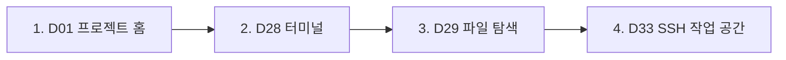

### 1. 홈에서 터미널 바로 열기

- **사용자 행동:** 프로젝트와 작업 위치를 확인해 터미널을 엽니다.
- **화면에서 확인할 변화:** 기획 절차를 거치지 않고 실제 셸 작업에 진입합니다.
- **다음 조건·행동:** 선택한 위치에서 명령을 실행합니다.
- **AI 역할:** AI 자동 실행 없음 · 사용자·호스트 동작

[와이어프레임](screens/wireframe/D01.png) · [화면 명세](SCREENS.md#d01) · [흐름의 이 단계 열기](index.html#flows?journey=U06&step=1)

### 2. 실제 셸에서 작업하기

- **사용자 행동:** 현재 경로와 세션을 확인하고 명령을 입력합니다.
- **화면에서 확인할 변화:** 터미널형 대화 스킨과 별개인 PTY 입출력이 동작합니다.
- **다음 조건·행동:** 필요한 파일을 탐색기에서 확인합니다.
- **AI 역할:** AI 자동 실행 없음 · 사용자·호스트 동작

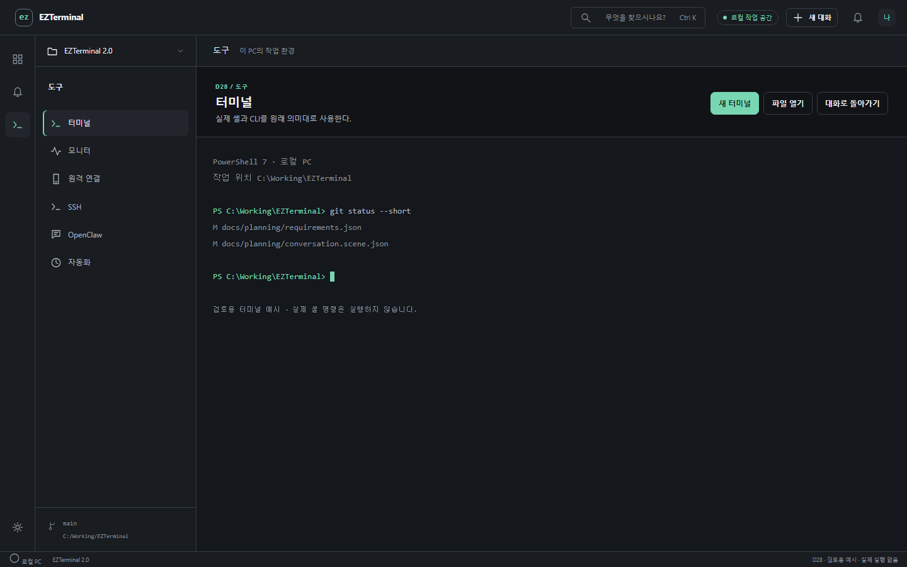

[와이어프레임](screens/wireframe/D28.png) · [화면 명세](SCREENS.md#d28) · [흐름의 이 단계 열기](index.html#flows?journey=U06&step=2)

### 3. 작업 위치의 파일 확인하기

- **사용자 행동:** 탐색기에서 파일과 경로를 확인합니다.
- **화면에서 확인할 변화:** 터미널의 작업 맥락을 유지하며 파일을 찾습니다.
- **다음 조건·행동:** 원격 작업이 필요하면 SSH 연결을 선택합니다.
- **AI 역할:** AI 자동 실행 없음 · 사용자·호스트 동작

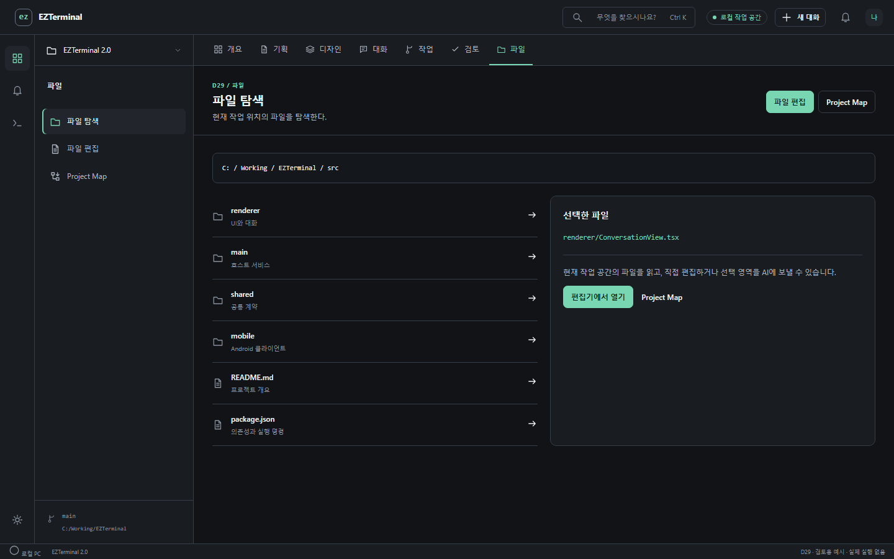

[와이어프레임](screens/wireframe/D29.png) · [화면 명세](SCREENS.md#d29) · [흐름의 이 단계 열기](index.html#flows?journey=U06&step=3)

### 4. 원격 위치를 확인하고 SSH 연결하기

- **사용자 행동:** 호스트·경로·연결 상태를 확인한 뒤 연결합니다.
- **화면에서 확인할 변화:** 로컬 작업과 원격 작업의 위치를 구분할 수 있습니다.
- **다음 조건·행동:** 원격 터미널에서 작업을 이어갑니다.
- **AI 역할:** AI 자동 실행 없음 · 사용자·호스트 동작

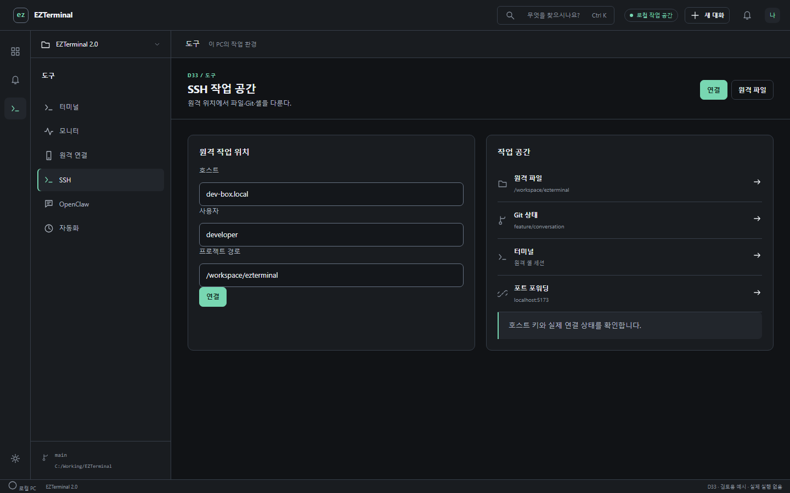

[와이어프레임](screens/wireframe/D33.png) · [화면 명세](SCREENS.md#d33) · [흐름의 이 단계 열기](index.html#flows?journey=U06&step=4)

### 예외·복구 — 재연결 전에 실행 상태를 확인합니다

- 행동: SSH 단절 뒤 원격 명령의 실행 여부와 세션 상태를 확인합니다.
- 결과: 확인 결과에 따라 재연결하거나 새 세션을 엽니다.
- 복귀 지점: 4단계. 실제 복귀는 오류가 발생하기 전 작업 위치를 우선합니다.

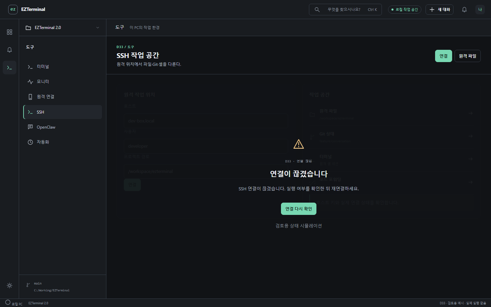

[복구 화면 체험](index.html#render/D33?state=offline&interactive=1)

## U07 PC 제어와 안전한 복귀

Android에서 PC 화면을 잠시 제어한 뒤 터미널 작업으로 돌아갑니다.

[이 흐름을 화면으로 보기](index.html#flows?journey=U07)

[M02 프로젝트 홈](SCREENS.md#m02) → [M11 PC 제어](SCREENS.md#m11) → [M09 터미널](SCREENS.md#m09)

- 완료: 명시적 시작 후 제어하고 기존 터미널로 돌아온다.
- 예외·복구: background·연결 끊김 → 입력 해제 → 사용자 Resume

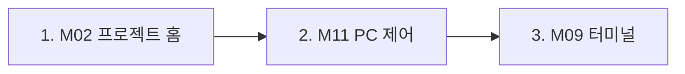

### 1. 연결된 PC의 제어 화면 열기

- **사용자 행동:** 홈에서 대상 PC와 연결 상태를 확인하고 PC 제어를 선택합니다.
- **화면에서 확인할 변화:** 제어를 시작할 대상을 분명히 확인합니다.
- **다음 조건·행동:** 제어 화면에서 사용자가 시작을 누릅니다.
- **AI 역할:** AI 자동 실행 없음 · 사용자·호스트 동작

[와이어프레임](screens/wireframe/M02.png) · [화면 명세](SCREENS.md#m02) · [흐름의 이 단계 열기](index.html#flows?journey=U07&step=1)

### 2. 명시적으로 시작하고 PC 조작하기

- **사용자 행동:** PC 제어 시작을 누르고 화면·포인터·키보드 입력을 사용합니다.
- **화면에서 확인할 변화:** 제어 중 상태와 종료 동작이 보입니다.
- **다음 조건·행동:** 제어를 종료한 뒤 터미널로 돌아갑니다.
- **AI 역할:** AI 자동 실행 없음 · 사용자·호스트 동작

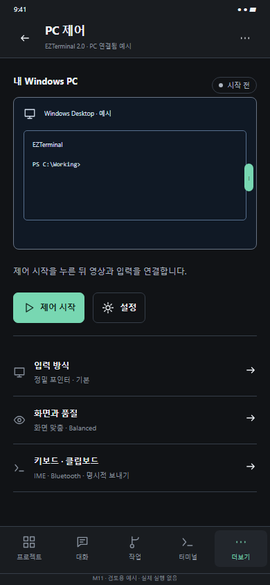

[와이어프레임](screens/wireframe/M11.png) · [화면 명세](SCREENS.md#m11) · [흐름의 이 단계 열기](index.html#flows?journey=U07&step=2)

### 3. 기존 터미널로 돌아오기

- **사용자 행동:** 터미널에서 이전 세션과 입력 상태를 확인합니다.
- **화면에서 확인할 변화:** PC 제어 전 작업의 맥락이 이어집니다.
- **다음 조건·행동:** 필요한 명령을 입력하며 작업을 계속합니다.
- **AI 역할:** AI 자동 실행 없음 · 사용자·호스트 동작

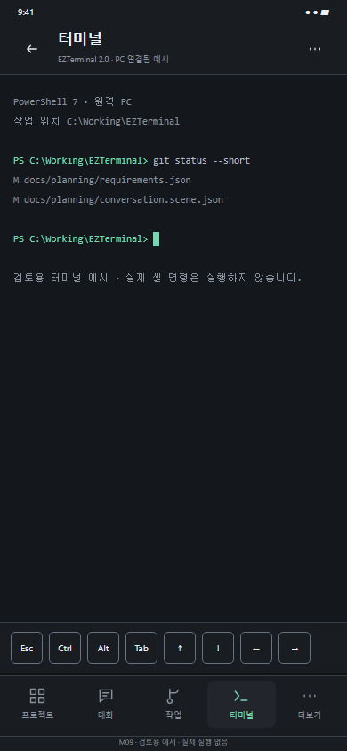

[와이어프레임](screens/wireframe/M09.png) · [화면 명세](SCREENS.md#m09) · [흐름의 이 단계 열기](index.html#flows?journey=U07&step=3)

### 예외·복구 — 연결이 끊기면 입력을 해제합니다

- 행동: 앱이 백그라운드로 가거나 연결이 끊기면 눌린 키·버튼을 해제합니다.
- 결과: 재연결되어도 자동 조작하지 않으며, 사용자가 Resume을 선택해 재개합니다.
- 복귀 지점: 2단계. 실제 복귀는 오류가 발생하기 전 작업 위치를 우선합니다.

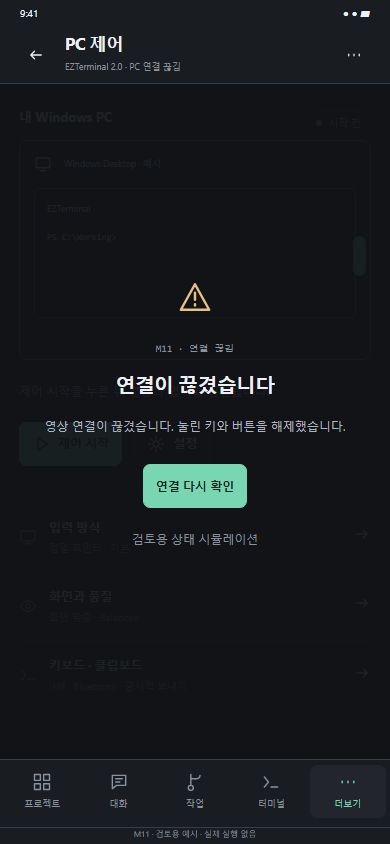

[복구 화면 체험](index.html#render/M11?state=offline&interactive=1)

## U08 설계 변경과 새 기준

확정된 설계가 있지만 요구사항이 바뀌었습니다. 진행 중인 실행의 기준을 보존하며 새 버전을 만듭니다.

[이 흐름을 화면으로 보기](index.html#flows?journey=U08)

[D13 버전 · 설계 확정](SCREENS.md#d13) → [D05 PRD](SCREENS.md#d05) → [D06 기능명세](SCREENS.md#d06) → [D16 작업 진행](SCREENS.md#d16) → [D10 화면 편집](SCREENS.md#d10) → [D13 버전 · 설계 확정](SCREENS.md#d13) → [D15 실행 준비](SCREENS.md#d15)

- 완료: 영향 작업과 후속 의존 작업만 확인받은 새 기준으로 재개하고 무관한 작업은 유지한다.
- 예외·복구: 영향 작업 검토가 남아 있으면 새 기준으로 실행하지 않음

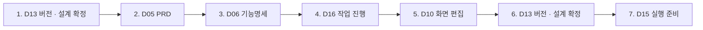

### 1. 현재 기준에서 새 초안 만들기

- **사용자 행동:** 기존 설계 버전을 확인하고 변경용 초안을 엽니다.
- **화면에서 확인할 변화:** 실행 중인 작업의 기준 설계는 그대로 남습니다.
- **다음 조건·행동:** 새 초안의 PRD를 수정합니다.
- **AI 역할:** AI 자동 실행 없음 · 사용자·호스트 동작

[와이어프레임](screens/wireframe/D13.png) · [화면 명세](SCREENS.md#d13) · [흐름의 이 단계 열기](index.html#flows?journey=U08&step=1)

### 2. 바뀐 요구사항 기록하기

- **사용자 행동:** 목표·범위·수용 조건 중 변경된 내용을 편집합니다.
- **화면에서 확인할 변화:** 무엇이 달라졌는지 이력과 연결 관계로 남습니다.
- **다음 조건·행동:** 영향을 받는 기능을 확인합니다.
- **AI 역할:** [기획 담당](AI-PROFILES.md#planning) · 요청·허용된 배정 시 적용

[와이어프레임](screens/wireframe/D05.png) · [화면 명세](SCREENS.md#d05) · [흐름의 이 단계 열기](index.html#flows?journey=U08&step=2)

### 3. 영향받는 기능 다시 검토하기

- **사용자 행동:** 변경된 요구사항과 연결된 기능·수용 기준을 갱신합니다.
- **화면에서 확인할 변화:** 다시 확인할 화면과 작업이 드러납니다.
- **다음 조건·행동:** 해당 화면 시안을 수정합니다.
- **AI 역할:** [기획 담당](AI-PROFILES.md#planning) · 요청·허용된 배정 시 적용

[와이어프레임](screens/wireframe/D06.png) · [화면 명세](SCREENS.md#d06) · [흐름의 이 단계 열기](index.html#flows?journey=U08&step=3)

### 4. 변경 계획과 영향 작업 확인하기

- **사용자 행동:** 영향 작업·후속 의존 작업·재작업 범위를 확인합니다.
- **화면에서 확인할 변화:** T04·T06만 보류하며 무관한 작업은 계속합니다. 이전 결과는 보존합니다.
- **다음 조건·행동:** 화면과 변경 계획을 검토한 뒤 새 기준을 적용합니다.
- **AI 역할:** [대표 AI](AI-PROFILES.md#coordinator) · 요청·허용된 배정 시 적용

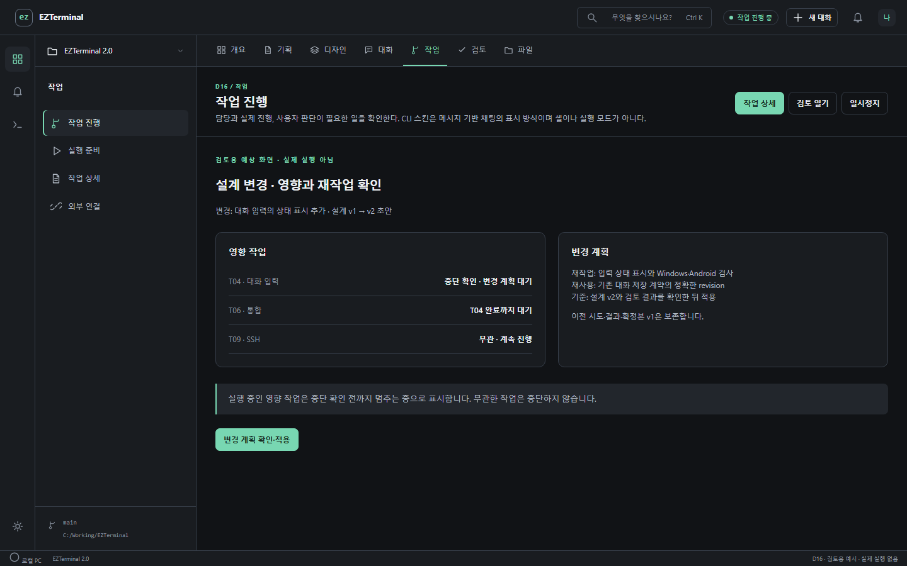

[와이어프레임](screens/policies/replan-impact-wireframe.png) · [화면 명세](SCREENS.md#d16) · [흐름의 이 단계 열기](index.html#flows?journey=U08&step=4)

### 5. 연결된 화면 초안 수정하기

- **사용자 행동:** 필요한 요소와 흐름을 고치고 미해결 의견을 검토합니다.
- **화면에서 확인할 변화:** 새 요구사항에 맞는 화면 초안이 준비됩니다.
- **다음 조건·행동:** 검토가 끝나면 새 기준 설계를 확정합니다.
- **AI 역할:** [화면 설계 담당](AI-PROFILES.md#designer) · 요청·허용된 배정 시 적용

[와이어프레임](screens/wireframe/D10.png) · [화면 명세](SCREENS.md#d10) · [흐름의 이 단계 열기](index.html#flows?journey=U08&step=5)

### 6. 새 설계 버전으로 확정하기

- **사용자 행동:** 이전 기준과 차이·검토 결과를 확인해 새 버전을 확정합니다.
- **화면에서 확인할 변화:** 이전 기준과 새 기준이 별도 버전으로 보존됩니다.
- **다음 조건·행동:** 새 실행이 참조할 버전을 명시적으로 선택합니다.
- **AI 역할:** AI 자동 실행 없음 · 사용자·호스트 동작

[와이어프레임](screens/wireframe/D13.png) · [화면 명세](SCREENS.md#d13) · [흐름의 이 단계 열기](index.html#flows?journey=U08&step=6)

### 7. 확인한 변경 계획으로 재개하기

- **사용자 행동:** 새 기준·재작업·선행조건을 확인해 변경 계획을 적용합니다.
- **화면에서 확인할 변화:** 영향 작업만 새 기준의 시도로 이어집니다. 이전 시도·결과는 변경하지 않습니다.
- **다음 조건·행동:** 배정과 검토 지점은 선택한 진행 정책을 따릅니다.
- **AI 역할:** [대표 AI](AI-PROFILES.md#coordinator) · 요청·허용된 배정 시 적용

[와이어프레임](screens/wireframe/D15.png) · [화면 명세](SCREENS.md#d15) · [흐름의 이 단계 열기](index.html#flows?journey=U08&step=7)

### 예외·복구 — 영향 검토가 남으면 새 기준 실행을 보류합니다

- 행동: 변경된 기능·화면·작업의 검토 의견을 해결합니다.
- 결과: 기존 실행 기준을 보존한 채 새 설계를 다시 검토하고 확정합니다.
- 복귀 지점: 6단계. 실제 복귀는 오류가 발생하기 전 작업 위치를 우선합니다.

[복구 화면 체험](index.html#render/D13?state=blocked&interactive=1)
