# 확정 정책과 설계 대응표

확정일: 2026-10-13. 11개 정책의 사용자 확정 기록이다. 이후 r6 전체 설계·P7·구현 진행 지시는 [승인 기록](APPROVAL.md)에 별도 보존한다. [화면으로 보기](index.html#policies) · [동작·데이터·복구 설계](POLICY-CONTRACTS.md).

원본: [policy-planning.mjs](policy-planning.mjs).

| ID | 확정 정책 | 동작 | 화면 | 구현 담당 |
| --- | --- | --- | --- | --- |
| I01 | 요구사항 변경 | 영향 작업과 후속 의존 작업만 멈추고 변경 계획·재작업 범위를 확인받아 재개한다. 무관한 작업과 이전 기준·결과는 유지한다. | [D13](SCREENS.md#d13), [D15](SCREENS.md#d15), [D16](SCREENS.md#d16), [D17](SCREENS.md#d17), [M07](SCREENS.md#m07), [M08](SCREENS.md#m08) | W01, W04, W06, W07 |
| I02 | 빠른 작업 시작 | 목표·대상·범위·완료 조건을 담은 요약 카드에서 사용자가 실행한다. 전체 PRD는 요구하지 않는다. | [D18](SCREENS.md#d18), [M04](SCREENS.md#m04) | W02, W03, W06 |
| I03 | 검증 실패 재시도 | 최초 검증 실패 후 기본 최대 2회 추가 수정·재검증한다. 횟수는 설정 가능하며 소진 시 시도와 남은 문제를 보존하고 사용자 판단을 기다린다. | [D15](SCREENS.md#d15), [D17](SCREENS.md#d17), [D36](SCREENS.md#d36), [M07](SCREENS.md#m07), [M15](SCREENS.md#m15) | W01, W06, W07 |
| I04 | 프로필 편집 | 모델·추론·지시문·참조 문맥·허용 도구를 직접 편집하고 저장·버전·되돌리기를 제공한다. AI도 수정안을 만들 수 있다. 상위 권한은 유지한다. | [D15](SCREENS.md#d15), [D36](SCREENS.md#d36), [M15](SCREENS.md#m15) | W01, W06 |
| I05 | AI 프로필 수정 적용 | AI는 변경 전후와 이유를 제시한다. 사용자 적용 후 새 버전으로 저장하며 진행 중 시도는 고정된 설정을 유지한다. | [D36](SCREENS.md#d36), [D17](SCREENS.md#d17), [M15](SCREENS.md#m15) | W01, W06 |
| I06 | 전체 기록 백업 | 기획·화면·확정본·역할 프로필·검토 기록과 대화 원문·실행 로그·캡처까지 기본 포함한다. 인증 정보는 제외하고 다른 PC에서 연결을 다시 확인한다. | [D25](SCREENS.md#d25), [D44](SCREENS.md#d44) | W01, W08, W09 |
| I07 | Android 오프라인 | 최근 동기화 내용 열람과 메시지 초안 작성을 허용한다. 마지막 동기화 시점을 표시하며 재연결 후 사용자가 확인해 전송한다. | [M04](SCREENS.md#m04), [M05](SCREENS.md#m05), [M07](SCREENS.md#m07), [M16](SCREENS.md#m16) | W01, W03 |
| I08 | 기록 보관 | 전체 기록을 자동 삭제하지 않는다. 저장 용량을 보여 주고 사용자가 프로젝트별로 직접 정리한다. | [D25](SCREENS.md#d25), [D38](SCREENS.md#d38), [M15](SCREENS.md#m15) | W01, W08 |
| I09 | 전체 실행 시간 | 전체 실행 시간 제한 없이 다음 검토·승인 지점까지 진행한다. 수동 중단과 검증 실패 재시도 제한은 유지한다. | [D15](SCREENS.md#d15), [D17](SCREENS.md#d17), [M07](SCREENS.md#m07) | W06 |
| I10 | 공통 UI 요소 | 반복 요소를 공통 원본에 연결하고 화면별 예외를 허용한다. 공통 변경은 연결된 초안에 반영하며 승인된 확정본은 유지한다. | [D10](SCREENS.md#d10), [D12](SCREENS.md#d12), [M06](SCREENS.md#m06) | W01, W05 |
| I11 | AI 연결·사용량 장애 | 해당 작업을 대기시키고 중단 이유와 대체 AI 선택지를 보여 준다. 임의로 전환하지 않으며 독립 작업은 계속한다. | [D17](SCREENS.md#d17), [D27](SCREENS.md#d27), [D36](SCREENS.md#d36), [M07](SCREENS.md#m07), [M08](SCREENS.md#m08) | W01, W06 |

## 정책별 수용 기준

- **I01 요구사항 변경:** T04 변경 시 T04·의존 T06만 보류하고 무관한 T09는 계속한다. 새 기준 승인 전 재배정하지 않는다.
- **I02 빠른 작업 시작:** 요청 입력과 카드 생성만으로 파일을 바꾸지 않는다. 실행 후 taskId·receipt가 붙으며 중복 클릭은 같은 결과를 가리킨다.
- **I03 검증 실패 재시도:** 기본값에서 최초 시도+추가 2회 이후 자동으로 네 번째 시도를 만들지 않는다. 재시작으로 횟수를 초기화하지 않는다.
- **I04 프로필 편집:** 8개 역할을 편집할 수 있고, 기획 프로필에 코드 실행 권한을 추가해도 상위 정책을 넘지 못한다.
- **I05 AI 프로필 수정 적용:** 제안·취소는 저장 버전을 바꾸지 않는다. v2 적용 후에도 실행 중 시도는 v1이고 새 실행만 v2를 사용한다.
- **I06 전체 기록 백업:** 다른 PC의 임시 프로젝트에 복원해 항목·참조·기록·캡처 해시를 대조한다. 인증·프로세스·실행 권한을 복원해 자동 실행하지 않는다.
- **I07 Android 오프라인:** 오프라인 초안은 앱 재시작 후에도 남고 재연결만으로 전송되지 않는다. 이미 보낸 미확정 명령과 미전송 초안을 구분한다.
- **I08 기록 보관:** 기간 경과·용량 부족만으로 기록을 지우지 않는다. 삭제 전 대상·참조 영향을 보이고 활성 실행·확정본 필수 자료는 보호한다.
- **I09 전체 실행 시간:** 경과 시간만으로 실행을 종료하지 않는다. 취소·연결 장애·개별 도구 실패·검토 대기를 무제한 반복 허용으로 해석하지 않는다.
- **I10 공통 UI 요소:** 공통 카드 변경은 연결된 초안에만 반영된다. 지정한 예외와 확정본은 보존되며 변경 묶음을 되돌릴 수 있다.
- **I11 AI 연결·사용량 장애:** 장애만으로 다른 제공자를 호출하지 않는다. 실행 여부가 불명확하면 대조 후 사용자 선택으로 새 시도를 만들고 설정·인계 내용을 기록한다.

## 예상 화면을 따라가는 검토

### PF01 빠른 작업의 명시적 시작

I02 · [이 흐름 열기](index.html#policies?flow=PF01)

#### 1. 요약 카드 확인

- 행동: 요청의 목표·범위·완료 조건을 확인하거나 수정합니다.
- 변화: 실행 전 상태로 남습니다.

[와이어프레임](screens/policies/quick-ready-wireframe.png) · [이 장면 체험](index.html#render/D18?policy=quick-ready&interactive=1)

#### 2. 실행 후 작업 추적

- 행동: 실행 버튼을 누릅니다.
- 변화: 작업 ID와 시작 기록이 표시됩니다. 같은 요청을 중복 실행하지 않습니다.

[와이어프레임](screens/policies/quick-running-wireframe.png) · [이 장면 체험](index.html#render/D18?policy=quick-running&interactive=1)

### PF02 진행 중 설계 변경

I01 · [이 흐름 열기](index.html#policies?flow=PF02)

#### 1. 영향 범위와 변경 계획

- 행동: 영향 작업·후속 작업·무관한 작업 및 재작업을 검토합니다.
- 변화: T04·T06만 보류하며 T09는 계속합니다.

[와이어프레임](screens/policies/replan-impact-wireframe.png) · [이 장면 체험](index.html#render/D16?policy=replan-impact&interactive=1)

#### 2. 새 기준으로 재개

- 행동: 정확한 변경 계획과 새 기준을 확인해 적용합니다.
- 변화: 이전 시도는 보존하고 새 기준의 시도를 배정합니다.

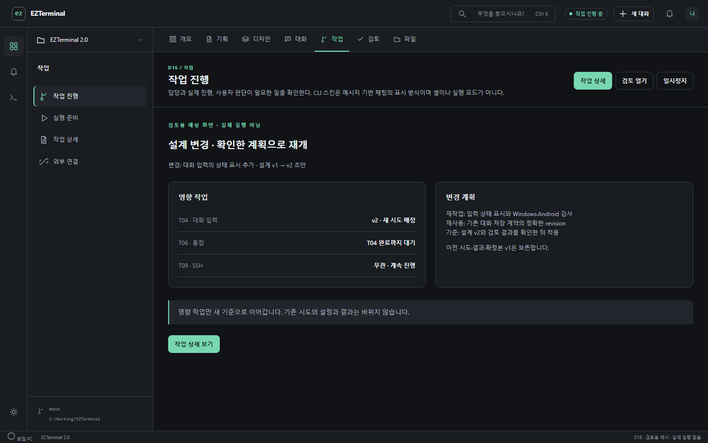

[와이어프레임](screens/policies/replan-approved-wireframe.png) · [이 장면 체험](index.html#render/D16?policy=replan-approved&interactive=1)

### PF03 검증 실패와 사용자 판단

I03 · I09 · [이 흐름 열기](index.html#policies?flow=PF03)

#### 1. 추가 수정과 검증

- 행동: 실패 근거·사용한 재시도·남은 횟수를 봅니다.
- 변화: 최초 실패 이후 추가 1/2회가 진행됩니다.

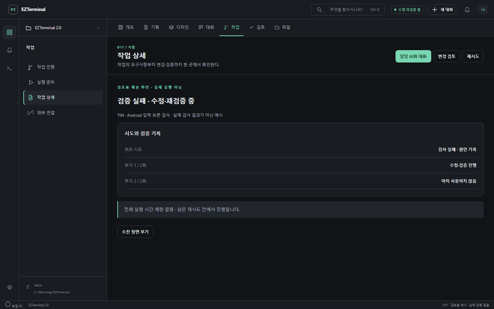

[와이어프레임](screens/policies/retry-active-wireframe.png) · [이 장면 체험](index.html#render/D17?policy=retry-active&interactive=1)

#### 2. 재시도 소진

- 행동: 각 시도의 결과와 남은 문제를 확인합니다.
- 변화: 추가 2/2회 이후 대기합니다. 시간 경과로 종료하거나 자동 3회째 재시도하지 않습니다.

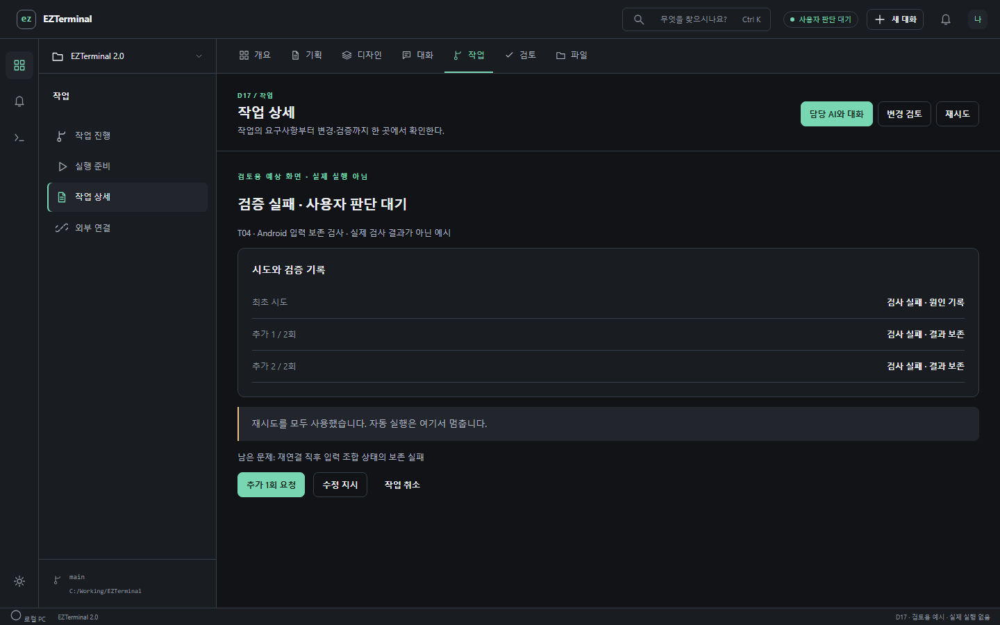

[와이어프레임](screens/policies/retry-exhausted-wireframe.png) · [이 장면 체험](index.html#render/D17?policy=retry-exhausted&interactive=1)

### PF04 AI와 역할 프로필 개선

I04 · I05 · [이 흐름 열기](index.html#policies?flow=PF04)

#### 1. 직접 편집 또는 AI 수정 요청

- 행동: 모델·지시문·문맥·도구를 조정하거나 개선을 요청합니다.
- 변화: 요청만으로 저장 버전은 바뀌지 않습니다.

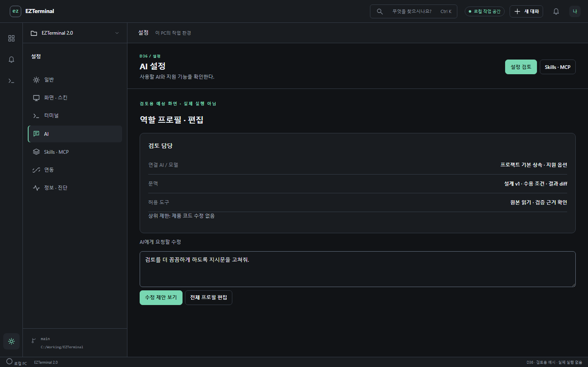

[와이어프레임](screens/policies/profile-edit-wireframe.png) · [이 장면 체험](index.html#render/D36?policy=profile-edit&interactive=1)

#### 2. 변경 전후와 이유 확인

- 행동: AI 제안의 변경 범위와 상위 권한 제한을 확인합니다.
- 변화: 적용 전 제안으로 남으며 취소할 수 있습니다.

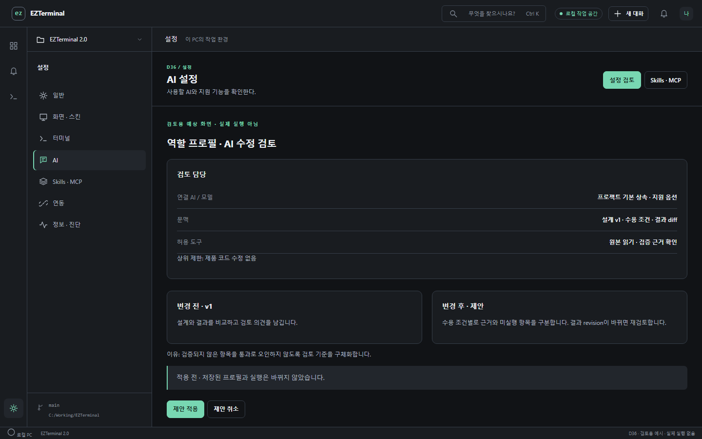

[와이어프레임](screens/policies/profile-proposal-wireframe.png) · [이 장면 체험](index.html#render/D36?policy=profile-proposal&interactive=1)

#### 3. 새 버전 저장

- 행동: 적용 버튼을 누릅니다.
- 변화: 새 실행은 v2, 진행 중 시도는 v1을 유지합니다. 이전 버전으로 되돌릴 수 있습니다.

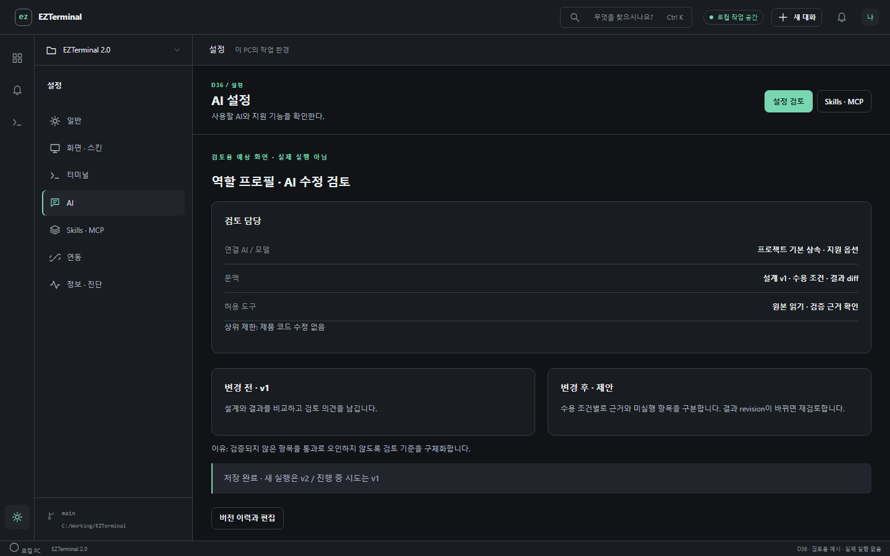

[와이어프레임](screens/policies/profile-applied-wireframe.png) · [이 장면 체험](index.html#render/D36?policy=profile-applied&interactive=1)

### PF05 AI 장애 후 사용자 선택

I11 · [이 흐름 열기](index.html#policies?flow=PF05)

#### 1. 해당 작업 대기

- 행동: 사용량 한도 또는 연결 장애 이유와 마지막 확인을 봅니다.
- 변화: 독립 작업은 진행하고 대체 AI는 아직 호출하지 않습니다.

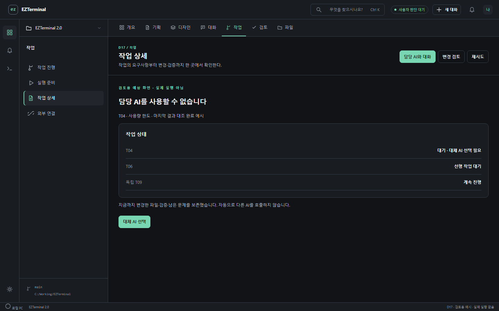

[와이어프레임](screens/policies/provider-wait-wireframe.png) · [이 장면 체험](index.html#render/D17?policy=provider-wait&interactive=1)

#### 2. 대체 AI와 인계 확인

- 행동: 사용 가능한 AI를 선택하고 인계 내용을 확인합니다.
- 변화: 결과 대조가 끝난 작업만 새 시도로 이어갈 수 있습니다.

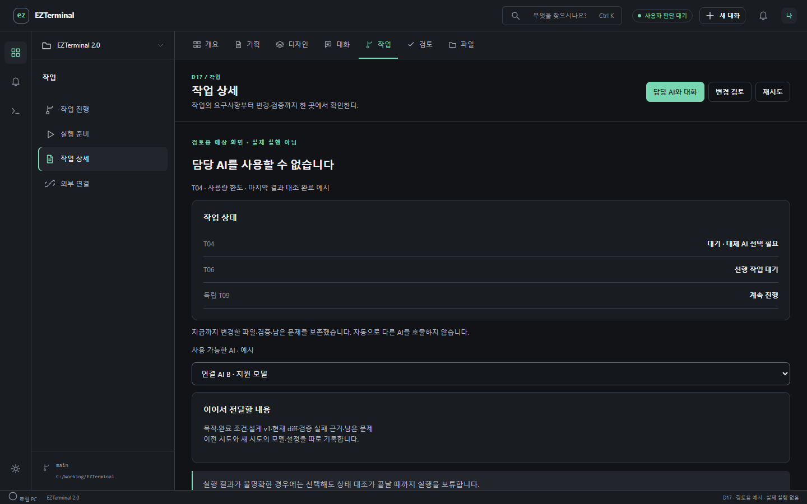

[와이어프레임](screens/policies/provider-choice-wireframe.png) · [이 장면 체험](index.html#render/D17?policy=provider-choice&interactive=1)

### PF06 백업·다른 PC 복원·용량 관리

I06 · I08 · [이 흐름 열기](index.html#policies?flow=PF06)

#### 1. 전체 기록 포함 확인

- 행동: 원본·대화·상세 로그·캡처와 용량을 확인합니다.
- 변화: 인증 정보를 제외한 일관된 snapshot을 만듭니다.

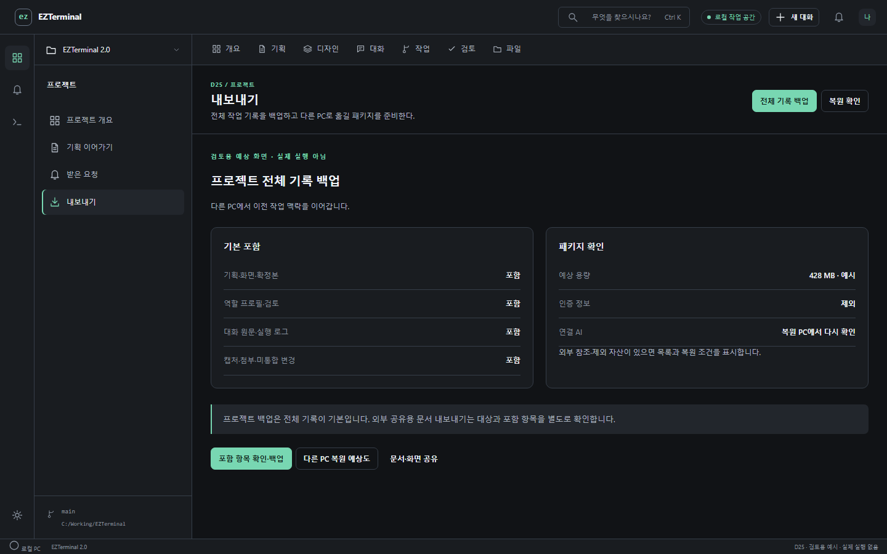

[와이어프레임](screens/policies/backup-wireframe.png) · [이 장면 체험](index.html#render/D25?policy=backup&interactive=1)

#### 2. 새 PC에서 복원 검토

- 행동: 무결성·경로 연결·사용 가능한 AI를 확인합니다.
- 변화: 원본을 덮어쓰지 않고 복원하며 실행은 별도 시작합니다.

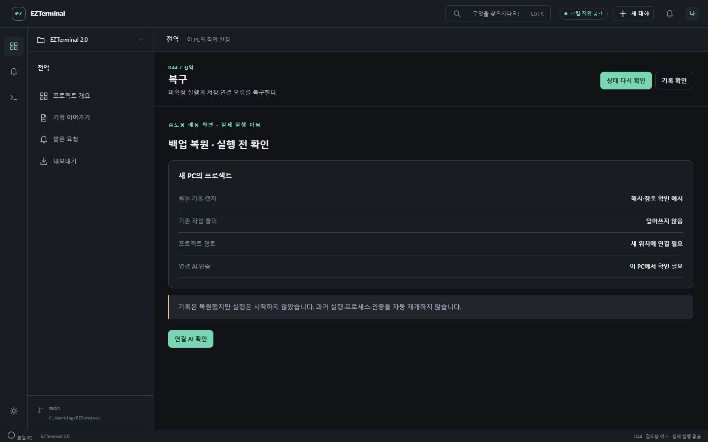

[와이어프레임](screens/policies/restore-wireframe.png) · [이 장면 체험](index.html#render/D44?policy=restore&interactive=1)

#### 3. 기록 직접 정리

- 행동: 프로젝트별 용량과 선택한 삭제 대상을 확인합니다.
- 변화: 자동 삭제하지 않습니다. 활성 실행·필수 참조는 삭제 대상에서 제외합니다.

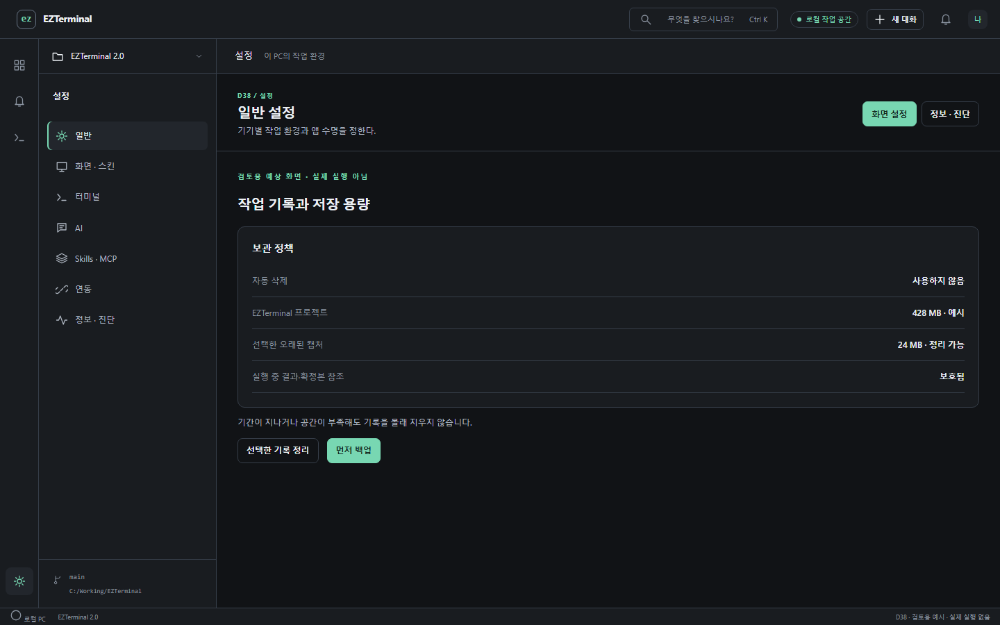

[와이어프레임](screens/policies/retention-wireframe.png) · [이 장면 체험](index.html#render/D38?policy=retention&interactive=1)

### PF07 Android 연결 단절과 초안

I07 · [이 흐름 열기](index.html#policies?flow=PF07)

#### 1. 저장된 내용과 초안

- 행동: 마지막 동기화 시각을 보고 메시지 초안을 작성합니다.
- 변화: 초안을 기기에 보관하며 AI·터미널 명령을 보내지 않습니다.

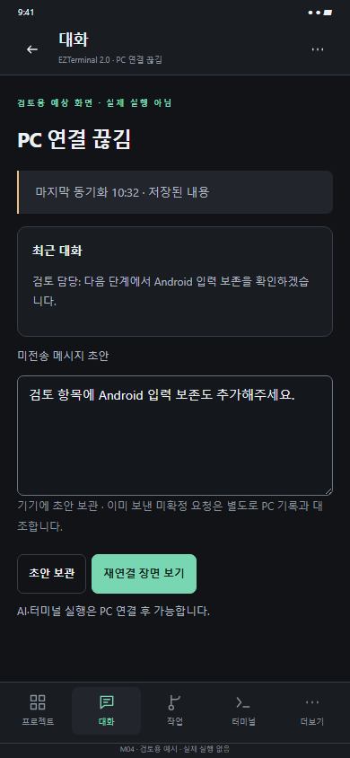

[와이어프레임](screens/policies/offline-draft-wireframe.png) · [이 장면 체험](index.html#render/M04?policy=offline-draft&interactive=1)

#### 2. 재연결 후 직접 전송

- 행동: PC·세션·최신 상태를 확인한 뒤 보내기를 누릅니다.
- 변화: 재연결만으로 전송되지 않습니다. 이미 보낸 요청은 먼저 PC 기록과 대조합니다.

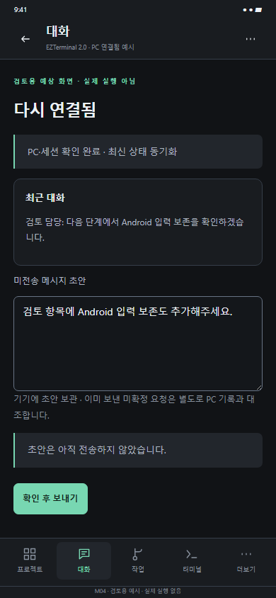

[와이어프레임](screens/policies/reconnected-draft-wireframe.png) · [이 장면 체험](index.html#render/M04?policy=reconnected-draft&interactive=1)

### PF08 공통 요소와 화면별 예외

I10 · [이 흐름 열기](index.html#policies?flow=PF08)

#### 1. 연결된 화면 확인

- 행동: 공통 카드의 상태와 초안 인스턴스·예외를 확인합니다.
- 변화: 같은 원본을 사용하는 화면과 변경 범위를 식별합니다.

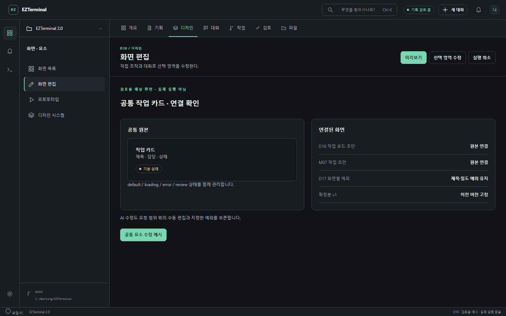

[와이어프레임](screens/policies/component-wireframe.png) · [이 장면 체험](index.html#render/D10?policy=component&interactive=1)

#### 2. 공통 변경 결과

- 행동: 공통 요소를 수정합니다.
- 변화: 연결 초안 2개가 갱신되고 지정한 예외와 확정본 v1은 유지됩니다.

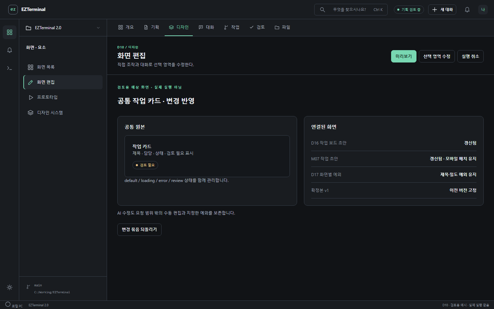

[와이어프레임](screens/policies/component-updated-wireframe.png) · [이 장면 체험](index.html#render/D10?policy=component-updated&interactive=1)

